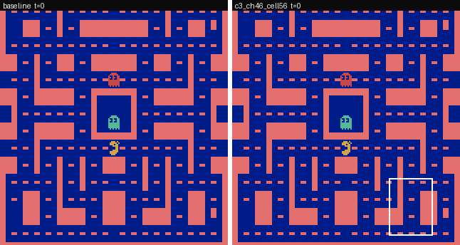
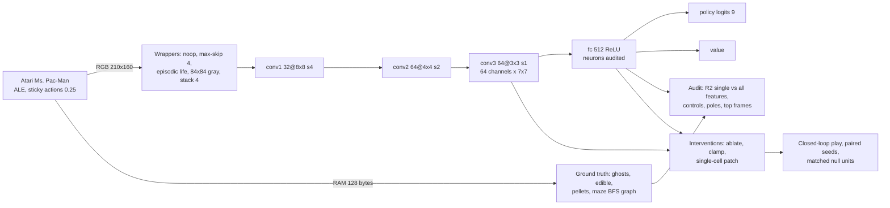

# Ms. Pac-Man neuron microscope: neuron-level interpretability and steering of reward-trained RL agents

This repository applies neuron-level mechanistic interpretability, in the style of Goodfire's
["Neural Networks Are Already Clean"](https://already-clean.goodfire.com/), to deep RL agents that learned Atari
**Ms. Pac-Man purely from game reward**: no imitation learning, no human data. For every alive fc neuron it asks two
questions. Which exact game fact does it track? What happens when we steer it during play?

**How it works**
- **Models.** Pretrained [Sample Factory](https://github.com/alex-petrenko/sample-factory) APPO agents
  ([Petrenko et al. 2020](https://arxiv.org/abs/2006.11751)):
  [seed 1111](https://huggingface.co/edbeeching/atari_2B_atari_mspacman_1111),
  [2222](https://huggingface.co/edbeeching/atari_2B_atari_mspacman_2222) and
  [3333](https://huggingface.co/edbeeching/atari_2B_atari_mspacman_3333), each trained for 2B emulator frames
  (about 500M agent steps at frameskip 4; `train_for_env_steps` with `summaries_use_frameskip` in their `cfg.json`).
- **Rebuild.** A plain-PyTorch rebuild of the network and the exact training wrapper chain, checked against a
  golden trajectory from real Sample Factory 2.0.3: observations are bit-exact, and logits agree to
  <!--n:fid_logit-->1.1e-05<!--/n--> on CPU. On the GPU used for data collection (cuDNN TF32 convolutions, PyTorch's
  default) they agree only to <!--n:fid_logit_gpu-->4.5e-02<!--/n-->.
- **Ground truth.** Decoded from the Atari console RAM:
  - positions, pellets and power pills, using [OCAtari](https://github.com/k4ntz/OC_Atari) and
    [AtariARI](https://github.com/mila-iqia/atari-representation-learning) addresses;
  - edible ghosts, from bit 7 of `ram[1+i]` and `ram[116]`. We identified these independently from pixels; they
    were already documented in [jev_deep_rl](https://github.com/taodav/jev_deep_rl) (Sep 2026);
  - maze distances on a lattice graph extracted from the screen.
- **Audit.** Every alive fc neuron is labelled Goodfire-style: positive and negative poles, top frames, a "one main
  job" score, and its direct vote on actions. The fraction of one-job neurons is compared with random directions,
  random unit mixtures and an untrained network.
- **Steering.** Causal tests in closed-loop play. Steered and baseline games are paired by seed and compared with
  matched null units: 99 random alive fc units for fc candidates, and the 63 other channels at the same cell for
  conv3 candidates. Hypotheses, metrics and falsification criteria were
  [preregistered](reports/preregistration.md) before any neuron-activation data, and the steering candidates were
  [frozen](reports/preregistration_addendum.md) before any held-out game.

**Highlights**

**Steering: one neuron creates a "no-go zone"** (agent 1111, confirmatory, held-out games).
- **Intervention.** Setting a *single* conv3 unit (channel 18 at one 7×7 position) to its 99th-percentile
  activation.
- **Effect.** The agent moves toward that part of the maze less often. Approach rate
  <!--n:appo_1111:c3_ch18_cell56:base-->0.424<!--/n--> → <!--n:appo_1111:c3_ch18_cell56:arm-->0.361<!--/n-->,
  Holm p <!--n:appo_1111:c3_ch18_cell56:p-->0.0002<!--/n--> (the smallest value the permutation test can give).
- **Specific.** It is stronger than every one of the
  <!--n:appo_1111:c3_ch18_cell56:null_n-->63<!--/n--> other channels set at the same position, each to its own
  99th percentile. The preregistered steering hypothesis (H2) is therefore **supported**.
- **Side effects.** Overall play gets worse: deaths per 1,000 steps Δ
  <!--n:appo_1111:c3_ch18_cell56:deaths_per_1k-->4.2 [3.3, 5.1]<!--/n-->, pellets per 1,000 steps Δ
  <!--n:appo_1111:c3_ch18_cell56:pellets_per_1k-->-12.2 [-20.8, -3.8]<!--/n-->.


**Removing one fc neuron reduces a specific ghost-chasing move** (agent 1111).
- **Effect.** Zero-ablating fc neuron 453, which votes for UP, reduces "move up when the nearest edible ghost is
  up" from
  <!--n:appo_1111:fc453_ablate:sec-->0.505 → 0.315 (Δ -0.190 [-0.209, -0.171])<!--/n--> (secondary metric, no null
  comparison).
- **Preregistered outcome.** Ghosts eaten per power pill drops only
  <!--n:appo_1111:fc453_ablate:base-->0.294<!--/n--> → <!--n:appo_1111:fc453_ablate:arm-->0.228<!--/n-->. That is
  not significant, so this candidate **fails** H2. Its effect (Δ
  <!--n:appo_1111:fc453_ablate:delta4-->-0.0659<!--/n-->) is larger than that of all
  <!--n:appo_1111:fc453_ablate:null_n-->99<!--/n--> random fc ablations tested, though the strongest null is
  nearly as large (Δ <!--n:appo_1111:fc453_ablate:null_best-->-0.0652<!--/n-->).
- **Caveat on the label.** Its best *direction* feature, "nearest edible ghost is up", does not survive confound
  control (stratified AUROC <!--n:appo_1111:fc453_ablate:auroc:dir_edible_up-->0.59<!--/n-->); its best feature
  overall is pellets left. It is active mostly in frightened mode
  (<!--n:appo_1111:fc453_ablate:fright_active-->88.8%<!--/n--> of its active steps vs
  <!--n:appo_1111:fc453_ablate:fright_base-->40.3%<!--/n--> of all steps). Its occlusion map peaks where Ms. Pac-Man
  is: she is within 12 px of the peak in
  <!--n:appo_1111:fc453_ablate:near_peak-->80.0% of its 50 top states<!--/n-->. So the effect most plausibly comes
  from its UP vote, not from a clean ghost-direction representation.

**"Already clean"? Not for this agent** (negative result).
- Fraction of alive fc neurons with one main job on held-out games, agent 1111:
  - agent <!--n:appo_1111:h1_agent-->0.8%<!--/n-->
  - random directions <!--n:appo_1111:h1_random_dirs-->0.2%<!--/n-->
  - untrained network <!--n:appo_1111:h1_untrained-->9.4%<!--/n-->
- The preregistered difference test is technically <!--n:appo_1111:h1_verdict-->supported<!--/n--> for agent
  1111 but trivially small, and it reverses at a looser threshold. For agents 2222 and 3333 it is
  <!--n:appo_2222:h1_verdict-->not supported<!--/n--> and <!--n:appo_3333:h1_verdict-->not supported<!--/n-->.
- Exploratory (discovery split-half, out-of-sample): a lookup table over Ms. Pac-Man's lattice node × heading (up to
  1,008 bins) gives a median R² of <!--n:appo_1111:place_heading_median-->0.20<!--/n--> per neuron. The best of the
  40 single features (≤ 20 bins each) gives <!--n:appo_1111:median_best_disc-->0.03<!--/n-->. Position, a joint
  x × y variable, does most of this; heading adds the rest. Gradient boosting on all features reaches
  <!--n:appo_1111:median_all_disc-->0.72<!--/n-->, so most neurons are well explained by game state, just not by
  one variable.

**Replication (H3).** Frozen selection rules were applied to independently trained agents 2222 and 3333:
- no-go-zone rule: <!--n:h3:c3_ch18_cell56-->replicates<!--/n-->;
- ghost-hunting ablation rule: <!--n:h3:fc453_ablate-->does not replicate<!--/n--> (exploratory: fc 453 already
  failed H2, and the preregistration defines H3 only for candidates that pass).

See [reports/05_replication.md](reports/05_replication.md).



**Interactive microscope.** Every alive fc neuron with its frames, label and action votes:
https://burnycoder.github.io/pacman-reinforcement-learning-neuron-mechanistic-interpretability/

**Paper:** [paper/paper.pdf](paper/paper.pdf).

**Hugging Face:**
- collection: <!--n:hf_collection-->https://huggingface.co/collections/BurnyCoder/ms-pac-man-rl-neuron-interpretability-6ae446b6c52e7e6af4d1bd8d<!--/n-->
- dataset with all results and unit atlases: <!--n:hf_dataset-->https://huggingface.co/datasets/BurnyCoder/mspacman-appo-neuron-atlas<!--/n-->


## Results

### Models
<!-- BEGIN:models -->
| agent | architecture | params | algorithm and objective | training data | discovery games (sticky p=0.25) | mean score ± SD | model-card score (no sticky) |
|---|---|---|---|---|---|---|---|
| [appo_1111](https://huggingface.co/edbeeching/atari_2B_atari_mspacman_1111) | Nature-CNN (SF convnet_atari): conv 32/64/64 -> fc 512 (ReLU) -> linear policy (9) + value | 1,689,258 | APPO (Sample Factory 2.0), maximise clipped game reward, gamma 0.99, no imitation | 2B emulator frames (≈500M agent steps at frameskip 4; cfg.json train_for_env_steps with summaries_use_frameskip) of interaction with MsPacmanNoFrameskip-v4 | 100 | 4082 ± 2032 | 6288 ± 1955 |
| [appo_2222](https://huggingface.co/edbeeching/atari_2B_atari_mspacman_2222) | Nature-CNN (SF convnet_atari): conv 32/64/64 -> fc 512 (ReLU) -> linear policy (9) + value | 1,689,258 | APPO (Sample Factory 2.0), maximise clipped game reward, gamma 0.99, no imitation | 2B emulator frames (≈500M agent steps at frameskip 4; cfg.json train_for_env_steps with summaries_use_frameskip) of interaction with MsPacmanNoFrameskip-v4 | 100 | 5161 ± 2056 | 9056 ± 2544 |
| [appo_3333](https://huggingface.co/edbeeching/atari_2B_atari_mspacman_3333) | Nature-CNN (SF convnet_atari): conv 32/64/64 -> fc 512 (ReLU) -> linear policy (9) + value | 1,689,258 | APPO (Sample Factory 2.0), maximise clipped game reward, gamma 0.99, no imitation | 2B emulator frames (≈500M agent steps at frameskip 4; cfg.json train_for_env_steps with summaries_use_frameskip) of interaction with MsPacmanNoFrameskip-v4 | 100 | 5056 ± 2358 | 6808 ± 1183 |
<!-- END:models -->

### Is each neuron "one job"? (H1; held-out games; method vs controls)
<!-- BEGIN:h1_appo_1111 -->
| unit set (held-out, confirmatory) | units | one-job fraction [95% CI] | median R²_all | median best single R² |
|---|---|---|---|---|
| trained agent (fc units) | 367 | 0.8% [0.8%, 0.8%] | 0.708 | 0.031 |
| random directions (control a) | 512 | 0.2% [0.2%, 0.6%] | 0.719 | 0.185 |
| non-negative unit mixtures (control b) | 512 | 1.4% [1.2%, 1.8%] | 0.720 | 0.053 |
| untrained network (control c) | 499 | 9.4% [5.2%, 11.6%] | 0.537 | 0.096 |

H1 test (agent minus random directions): 0.6% [0.2%, 0.6%]; H1 supported.
<!-- END:h1_appo_1111 -->


### Steering (H2; held-out games; candidates vs matched null units; positive control)
<!-- BEGIN:steer_appo_1111 -->
| intervention | primary metric (predicted sign) | baseline → steered | Δ [95% CI] | Holm p | above null 95th pct? | H2 |
|---|---|---|---|---|---|---|
| fc neuron 453 zero-ablated | ghosts_per_pill (−) | 0.294 → 0.228 | -0.066 [-0.192, 0.101] | 0.2280 | yes (null q95 0.013) | fail |
| conv3 channel 18 set to its p99 at cell (5,6) | approach (−) | 0.424 → 0.361 | -0.063 [-0.077, -0.050] | 0.0002 | yes (null q95 0.013) | pass |
| fc neuron 188 clamped to its p99 (constant logit bias, DLA UP -0.70) (positive control) | action_given_trigger (−) | 0.395 → 0.305 | -0.090 [-0.102, -0.079] | – | – | – |

p = 0.0001 is the smallest attainable value of the 10,000-permutation sign-flip test (1/10,001); 0.0002 is that floor after Holm over 2 tests, so it means p ≤ that value. The positive control's frozen label says "constant logit bias": clamping unit n to v shifts the logits by (v − h_n(s))·W_π[:, n], which is constant only on steps where the unit is inactive (fc 188: active on 2.1% of in-control discovery steps).
<!-- END:steer_appo_1111 -->

Off-target effects (ablation and steering damage):
<!-- BEGIN:offtarget_appo_1111 -->
| intervention | off-target metric | Δ [95% CI] | two-sided p | BH q |
|---|---|---|---|---|
| fc neuron 453 zero-ablated | return | -1619 [-2194, -1056] | 0.0001 | 0.0001 |
| fc neuron 453 zero-ablated | deaths_per_1k | 1.14 [0.75, 1.52] | 0.0001 | 0.0001 |
| fc neuron 453 zero-ablated | pellets_per_1k | -9.23 [-17.68, -0.84] | 0.0416 | 0.0468 |
| fc neuron 453 zero-ablated | in_control | -469 [-633, -304] | 0.0001 | 0.0001 |
| conv3 channel 18 set to its p99 at cell (5,6) | return | -2490 [-2990, -2005] | 0.0001 | 0.0001 |
| conv3 channel 18 set to its p99 at cell (5,6) | deaths_per_1k | 4.17 [3.27, 5.14] | 0.0001 | 0.0001 |
| conv3 channel 18 set to its p99 at cell (5,6) | pellets_per_1k | -12.16 [-20.78, -3.83] | 0.0071 | 0.0091 |
| conv3 channel 18 set to its p99 at cell (5,6) | ghosts_per_pill | -0.05 [-0.18, 0.09] | 0.5156 | 0.5156 |
| conv3 channel 18 set to its p99 at cell (5,6) | in_control | -788 [-944, -633] | 0.0001 | 0.0001 |

p = 0.0001 is the smallest attainable value of the 10,000-permutation sign-flip test (1/10,001), so it means p ≤ that value.
<!-- END:offtarget_appo_1111 -->


**In plain language.**
- **Labels.** Single game facts are not how this agent's neurons are organised. Many neurons are better described
  as "Ms. Pac-Man is around here, heading this way" than as "a ghost is near" (an exploratory, post-hoc finding).
  Random directions in the same layer are about equally (un)clean.
- **Steering.** The causal tests show which single units still matter for one behaviour, and the null units show
  how much damage a random unit of the same layer would cause.
- More: [summary of all experiments](reports/00_summary.md), with a glossary and a layman explanation.

## Method


1. **Fidelity** ([report](reports/01_fidelity.md)). The training-era stack (sample-factory 2.0.3, gym 0.26.2,
   ale-py 0.8.1) runs in WSL and produces a golden trajectory. Our Windows environment reproduces its observations
   bit-exactly and our model its logits to 1.1e-5 on CPU (GPU/TF32 differences are reported separately).
2. **Ground truth** ([report](reports/02_ram_ground_truth.md)). RAM decoding is validated against pixels; 40
   features in 5 families.
3. **Data.** 100 discovery and 100 held-out full games per agent. Actions are sampled from the policy with a
   per-game RNG (common random numbers), and sticky actions are on (preregistered fallback). All fc
   pre-activations and conv3 activations are recorded.
4. **Audit** ([report](reports/03_neuron_audit.md)).
   - Per unit: out-of-sample R² for each single feature, a gradient-boosting ceiling on all features, and a
     "one job" score.
   - Controls: random orthonormal directions, non-negative unit mixtures, and an untrained network on the same
     states.
   - Game-cluster bootstrap CIs.
5. **Steering** ([report](reports/04_steering.md)).
   - Exact open-loop screens: a rank-1 update for conv3 patches, logit shifts for fc ablations.
   - Closed-loop pilots on discovery seeds, then ≤ 2 frozen candidates tested on held-out seeds.
   - Each candidate is compared with the unsteered baseline (paired sign-flip test, Holm) and with null units
     given the same intervention: 99 random alive fc units, or the 63 other conv3 channels at the same cell.
   - An unsteered A/A arm checks the pairing: <!--n:appo_1111:aa_identical-->50 of 50<!--/n--> unsteered games
     replay their paired baseline game action for action (agent 1111).
6. **Replication** ([report](reports/05_replication.md)) on agents 2222 and 3333, with selection rules frozen in
   advance.

What happens when you run it:
- `collect-discovery` / `collect-heldout` play games in `NUM_WORKERS` (default 12) worker processes with 3
  concurrent games each, and batch observations through the network on the GPU.
- Each finished game is written to `DATA_DIR/rollouts/<agent>/<split>/seed_*.npz`: RAM, actions, logits, conv3
  activations, fc pre-activations, and the untrained network's fc pre-activations.
- `audit`, `screen`, `pilot`, `h1`, `confirm` and the other analysis phases read those files and write small JSON
  summaries to `results/` ([docs/pipeline.md](docs/pipeline.md) lists every phase).
- `report` turns `results/` into every results table, inline number and static figure in this README, the reports
  and the paper. Videos come from the `videos` phase, the PDF from `scripts/build_paper.py`. The numbers inside the
  frozen preregistration files were written by hand before any results existed.
- `site` re-renders top-activating frames by deterministic replay for the microscope.

## Setup and usage
```bash
uv sync
```
```bash
cp .env.example .env
```
```bash
uv run pytest
```
```bash
uv run python -m pacneuron.pipeline --phase collect-discovery,stochasticity,audit,screen,pilot --seed 1111
```
```bash
uv run python -m pacneuron.pipeline --phase collect-heldout,h1,confirm,videos,report,site --seed 1111
```
- `uv sync` creates a Python 3.12 venv with torch CUDA 13.0 wheels.
- In `.env`, set `DATA_DIR` and `HF_HOME`. Rollouts take about 1.3–1.6 GB per agent per split, and steering arms
  0.4–0.7 GB per agent (about 11 GB for the full three-agent study).
- `uv run pytest` runs the fidelity gate (needs `tests/fixtures/sf_golden.npz`, committed) and the unit tests.
- Held-out phases refuse to run unless `results/candidates.json` and the addendum are committed
  (`pacneuron.prereg`).
- Rebuild the golden fixture (Linux/WSL):
  `bash scripts/sf_golden_wsl.sh /mnt/c/<path-to-repo>`.
- Reproduce the preregistered no-sticky stochasticity check. It writes `*_nosticky` files and refuses any other
  phase: `STICKY=0 uv run python -m pacneuron.pipeline --phase collect-discovery,stochasticity --seed 1111`.
- Requirements: Windows or Linux and about 16 CPU threads recommended. An NVIDIA GPU is optional: set
  `DEVICE=cpu` in `.env` to run on CPU, which is slower. A full run per agent takes a few hours, dominated by the
  null-unit steering arms.

## Features
- Re-implementation of Sample Factory's Atari agent with no Sample Factory dependency on Windows. Observations
  are bit-exact; logits agree to 1.1e-5 on CPU.
- RAM ground truth for Ms. Pac-Man, including the frightened-mode addresses (pixel-validated), a maze lattice
  graph with BFS distances, and conv3-cell object maps.
- Goodfire-style neuron audit with three controls and game-cluster bootstrap CIs.
- Exact open-loop screens and closed-loop steering with paired seeds, matched nulls and an A/A pairing check.
- Preregistration lock, a single-command report regeneration, and an interactive GitHub Pages microscope.

## Repository layout
- `src/pacneuron/`:
  - `env.py`, `worker.py`, `rollout.py`: environment and parallel play;
  - `model.py`: the agent and interventions;
  - `ram.py`, `maze.py`, `features.py`: ground truth;
  - `audit.py`, `screen.py`, `steer.py`, `metrics.py`, `stats.py`: analysis;
  - `phases.py`, `pipeline.py`: entry points;
  - `report.py`, `viz.py`, `render.py`, `export.py`: outputs;
  - `prereg.py`: the preregistration lock.
- `tests/`: the fidelity gate and unit tests (planted neurons, statistics calibration, intervention algebra).
- `reports/`: the preregistration, its addendum, one report per experiment, and the summary.
- `paper/`: the paper (Markdown → PDF). `site/`: the microscope. `docs/`: documentation. `results/`: JSON
  results. `figures/`: generated figures and videos.

## Technologies
- PyTorch 2.14 (CUDA 13.0), Gymnasium 1.4, ale-py 0.12, OpenCV.
- NumPy, SciPy, scikit-learn, joblib, Matplotlib, Pillow, imageio.
- Hugging Face Hub, uv, pytest, GitHub Actions and Pages.

## Related work
- Saliency on Atari agents including Ms. Pac-Man: [Greydanus et al. 2018](https://arxiv.org/abs/1711.00138).
- Attention maps of Atari agents including Ms. Pac-Man: [Mott et al. 2019](https://arxiv.org/abs/1906.02500).
- NMF concepts for policy distillation, including Ms. Pac-Man:
  [Bekkemoen & Langseth 2025](https://mlanthology.org/mlj/2025/bekkemoen2025mlj-interpretable/).
- An Atari model zoo with neuron visualisation: [Such et al. 2019](https://arxiv.org/abs/1812.07069).
- Feature visualisation and attribution on CoinRun: [Hilton et al. 2020](https://distill.pub/2020/understanding-rl-vision/).
- Channel-level retargeting of a maze agent: [Mini et al. 2023](https://arxiv.org/abs/2310.08043).
- Planning representations and probe steering in Sokoban:
  [Taufeeque et al. 2024](https://arxiv.org/abs/2407.15421), [Bush et al. 2025](https://arxiv.org/abs/2504.01871);
  channel-level planning circuits in the same agent: [Taufeeque et al. 2025](https://arxiv.org/abs/2506.10138).
- An SAE on a Ms. Pac-Man DQN, without interventions:
  [DuPlessie 2024](https://math.mit.edu/research/highschool/primes/materials/2024/DuPlessie.pdf).
- Object-centric Atari RAM extraction: [Delfosse et al. 2023](https://arxiv.org/abs/2306.08649); Atari RAM
  annotations: [Anand et al. 2019](https://arxiv.org/abs/1906.08226); Ms. Pac-Man frightened-mode registers:
  [jev_deep_rl](https://github.com/taodav/jev_deep_rl).
- Sticky actions: [Machado et al. 2018](https://arxiv.org/abs/1709.06009).
