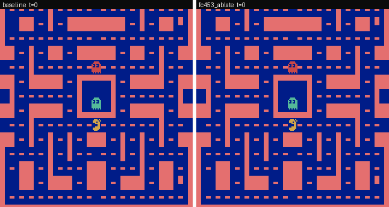
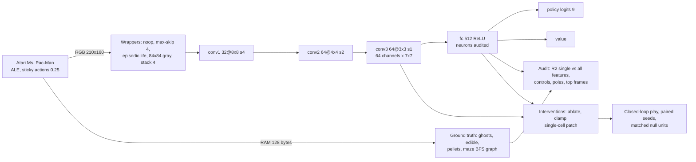

# Ms. Pac-Man neuron microscope: neuron-level interpretability and steering of reward-trained RL agents

This repository applies neuron-level mechanistic interpretability, in the style of Goodfire's
["Neural Networks Are Already Clean"](https://already-clean.goodfire.com/), to deep RL agents that learned Atari
**Ms. Pac-Man purely from game reward**: no imitation learning, no human data. For every neuron it asks two
questions. Which exact game fact does it track? What happens when we steer it during play?

**How it works**
- **Models.** Pretrained [Sample Factory](https://github.com/alex-petrenko/sample-factory) APPO agents:
  [seed 1111](https://huggingface.co/edbeeching/atari_2B_atari_mspacman_1111),
  [2222](https://huggingface.co/edbeeching/atari_2B_atari_mspacman_2222) and
  [3333](https://huggingface.co/edbeeching/atari_2B_atari_mspacman_3333), each trained for 2B steps.
- **Rebuild.** A plain-PyTorch rebuild of the network and the exact training wrapper chain. It is verified
  bit-exact against real Sample Factory: max logit difference <!--n:fid_logit-->1.1e-05<!--/n-->.
- **Ground truth.** Decoded from the Atari console RAM:
  - ghost positions, using [OCAtari](https://github.com/k4ntz/OC_Atari) and
    [AtariARI](https://github.com/mila-iqia/atari-representation-learning) addresses;
  - edible ghosts, from RAM addresses found in this project (`ram[116]`, bit 7 of `ram[1+i]`);
  - maze distances on a lattice graph extracted from the screen.
- **Audit.** Every neuron is labelled Goodfire-style: positive and negative poles, top frames, a "one main job"
  score, and its direct vote on actions. Each neuron is compared with random directions, random unit mixtures and
  an untrained network.
- **Steering.** Causal tests in closed-loop play. Steered and baseline games are paired by seed and compared with
  matched random-unit nulls. Hypotheses, metrics and falsification criteria were
  [preregistered](reports/preregistration.md) before any data, and the steering candidates were
  [frozen](reports/preregistration_addendum.md) before any held-out game.

**Highlights (agent 1111)**
- **Negative result for "already clean".**
  - Fraction of alive fc neurons with one main job, on held-out games:
    - agent <!--n:appo_1111:h1_agent-->0.8%<!--/n-->
    - random directions <!--n:appo_1111:h1_random_dirs-->0.2%<!--/n-->
    - untrained network <!--n:appo_1111:h1_untrained-->9.4%<!--/n-->
  - H1 is <!--n:appo_1111:h1_verdict-->supported<!--/n-->.
  - Neurons are explained by *combinations* of game facts. Exploratory: where Ms. Pac-Man is × which way she
    faces gives a median R² of <!--n:appo_1111:place_heading_median-->0.20<!--/n--> per neuron, vs
    <!--n:appo_1111:median_best_disc-->0.03<!--/n--> for the best single feature.
- **Steering (confirmatory, held-out games).**
  - fc neuron 453 zero-ablated: ghosts eaten per power pill
    <!--n:appo_1111:fc453_ablate:base-->0.294<!--/n--> → <!--n:appo_1111:fc453_ablate:arm-->0.228<!--/n-->
    (<!--n:appo_1111:fc453_ablate:pass-->fails<!--/n--> the preregistered test).
  - conv3 channel 18 set at one 7×7 cell: rate of approaching that maze location
    <!--n:appo_1111:c3_ch18_cell56:base-->0.424<!--/n--> → <!--n:appo_1111:c3_ch18_cell56:arm-->0.361<!--/n-->
    (<!--n:appo_1111:c3_ch18_cell56:pass-->passes<!--/n-->).
  - Details, nulls and off-target damage are in [reports/04_steering.md](reports/04_steering.md).
- **Interactive microscope.** Every neuron with its frames, label and action votes:
  https://burnycoder.github.io/pacman-reinforcement-learning-neuron-mechanistic-interpretability/



## Results

### Models
<!-- BEGIN:models -->
| agent | architecture | params | algorithm and objective | training data | discovery games (sticky p=0.25) | mean score ± SD | model-card score (no sticky) |
|---|---|---|---|---|---|---|---|
| [appo_1111](https://huggingface.co/edbeeching/atari_2B_atari_mspacman_1111) | Nature-CNN: conv 32/64/64 -> fc 512 (ReLU) -> linear policy (9) + value | 1,689,258 | APPO (Sample Factory 2.0), maximise clipped game reward, gamma 0.99, no imitation | 2B env steps of interaction with MsPacmanNoFrameskip-v4 | 100 | 4082 ± 2032 | 6288 ± 1955 |
| [appo_2222](https://huggingface.co/edbeeching/atari_2B_atari_mspacman_2222) | Nature-CNN: conv 32/64/64 -> fc 512 (ReLU) -> linear policy (9) + value | 1,689,258 | APPO (Sample Factory 2.0), maximise clipped game reward, gamma 0.99, no imitation | 2B env steps of interaction with MsPacmanNoFrameskip-v4 | 100 | 5161 ± 2056 | 9056 ± 2544 |
| [appo_3333](https://huggingface.co/edbeeching/atari_2B_atari_mspacman_3333) | Nature-CNN: conv 32/64/64 -> fc 512 (ReLU) -> linear policy (9) + value | 1,689,258 | APPO (Sample Factory 2.0), maximise clipped game reward, gamma 0.99, no imitation | 2B env steps of interaction with MsPacmanNoFrameskip-v4 | 100 | 5056 ± 2358 | 6808 ± 1183 |
<!-- END:models -->

### Is each neuron "one job"? (H1; held-out games; method vs controls)
<!-- BEGIN:h1_appo_1111 -->
| unit set (held-out, confirmatory) | units | one-job fraction [95% CI] | median R²_all | median best single R² |
|---|---|---|---|---|
| trained agent (fc units) | 367 | 0.8% [0.8%, 0.8%] | 0.708 | 0.031 |
| random directions (control a) | 512 | 0.2% [0.2%, 0.6%] | 0.719 | 0.185 |
| non-negative unit mixtures (control b) | 512 | 1.4% [1.2%, 1.8%] | 0.720 | 0.053 |
| untrained network (control c) | 499 | 9.4% [5.2%, 11.6%] | 0.537 | 0.096 |

H1 test (agent minus random directions): 0.6% [0.2%, 0.6%]; H1 supported.
<!-- END:h1_appo_1111 -->


### Steering (H2; held-out games; candidates vs matched null units; positive control)
<!-- BEGIN:steer_appo_1111 -->
| intervention | primary metric (predicted sign) | baseline → steered | Δ [95% CI] | Holm p | above null 95th pct? | H2 |
|---|---|---|---|---|---|---|
| fc neuron 453 zero-ablated | ghosts_per_pill (−) | 0.294 → 0.228 | -0.066 [-0.192, 0.101] | 0.2280 | yes (null q95 0.013) | fail |
| conv3 channel 18 set to its p99 at cell (5,6) | approach (−) | 0.424 → 0.361 | -0.063 [-0.077, -0.050] | 0.0002 | yes (null q95 0.013) | pass |
| fc neuron 188 clamped to its p99 (constant logit bias, DLA UP -0.70) (positive control) | action_given_trigger (−) | 0.395 → 0.305 | -0.090 [-0.102, -0.079] | – | – | – |
<!-- END:steer_appo_1111 -->

Off-target effects (ablation and steering damage):
<!-- BEGIN:offtarget_appo_1111 -->
| intervention | Δ return | Δ deaths / 1k steps | Δ pellets / 1k steps | Δ ghosts per pill |
|---|---|---|---|---|
| fc neuron 453 zero-ablated | -1619 [-2194, -1056] | 1.14 [0.75, 1.52] | -9.23 [-17.68, -0.84] | -0.07 [-0.19, 0.10] |
| conv3 channel 18 set to its p99 at cell (5,6) | -2490 [-2990, -2005] | 4.17 [3.27, 5.14] | -12.16 [-20.78, -3.83] | -0.05 [-0.18, 0.09] |
<!-- END:offtarget_appo_1111 -->


**In plain language.**
- **Labels.** Single game facts are not how this agent's neurons are organised. A neuron typically responds to
  "Ms. Pac-Man is around here, heading this way" rather than "a ghost is near". Random mixes of neurons are about
  equally (un)clean.
- **Steering.** The causal tests show which single units still matter for one behaviour, and the null units show
  how much damage a random unit of the same layer would cause.
- More: [summary of all experiments](reports/00_summary.md), with a glossary and a layman explanation.

## Method


1. **Fidelity** ([report](reports/01_fidelity.md)). The training-era stack (sample-factory 2.0.3, gym 0.26.2,
   ale-py 0.8.1) runs in WSL and produces a golden trajectory. Our Windows environment and model reproduce it.
2. **Ground truth** ([report](reports/02_ram_ground_truth.md)). RAM decoding is validated against pixels; 40
   features in 5 families.
3. **Data.** 100 discovery and 100 held-out full games per agent. Actions are sampled from the policy with a
   per-game RNG (common random numbers), and sticky actions are on (preregistered fallback). All fc and conv3
   activations are recorded.
4. **Audit** ([report](reports/03_neuron_audit.md)).
   - Per unit: out-of-sample R² for each single feature, a gradient-boosting ceiling on all features, and a
     "one job" score.
   - Controls: random orthonormal directions, non-negative unit mixtures, and an untrained network on the same
     states.
   - Game-cluster bootstrap CIs.
5. **Steering** ([report](reports/04_steering.md)).
   - Exact open-loop screens: a rank-1 update for conv3 patches, logit shifts for fc ablations.
   - Closed-loop pilots on discovery seeds, then ≤ 2 frozen candidates tested on held-out seeds.
   - Each candidate is compared with the unsteered baseline (paired sign-flip test, Holm) and with a null of
     random units given the same intervention.
6. **Replication** ([report](reports/05_replication.md)) on agents 2222 and 3333, with selection rules frozen in
   advance.

What happens when you run it:
- `collect` plays games in 12 worker processes and batches observations through the network on the GPU.
- Each finished game is written to `DATA_DIR/rollouts/<agent>/<split>/seed_*.npz`: RAM, actions, logits, conv3
  and fc activations, and the untrained network's fc activations.
- `audit`, `screen`, `pilot`, `h1` and `confirm` read those files and write small JSON summaries to `results/`.
- `report` turns `results/` into every table, figure and inline number in this README, the reports and the
  paper.
- `site` re-renders top-activating frames by deterministic replay for the microscope.

## Setup and usage
```bash
uv sync
```
```bash
cp .env.example .env
```
```bash
uv run pytest
```
```bash
uv run python -m pacneuron.pipeline --phase collect-discovery,stochasticity,audit,screen,pilot --seed 1111
```
```bash
uv run python -m pacneuron.pipeline --phase collect-heldout,h1,confirm,videos,report,site --seed 1111
```
- `uv sync` creates a Python 3.12 venv with torch CUDA 13.0 wheels.
- In `.env`, set `DATA_DIR` (bulk activations, ~2 GB per agent per split) and `HF_HOME`.
- `uv run pytest` runs the fidelity gate (needs `tests/fixtures/sf_golden.npz`, committed) and the unit tests.
- Held-out phases refuse to run unless `results/candidates.json` and the addendum are committed
  (`pacneuron.prereg`).
- Rebuild the golden fixture (Linux/WSL):
  `bash scripts/sf_golden_wsl.sh /mnt/c/<path-to-repo>`.
- Requirements: Windows or Linux, an NVIDIA GPU (optional; CPU works, slower), about 16 CPU threads
  recommended. A full run per agent takes a few hours, dominated by the null-unit steering arms.

## Features
- Bit-exact re-implementation of Sample Factory's Atari agent (no Sample Factory dependency on Windows).
- RAM ground truth for Ms. Pac-Man, including newly found frightened-mode addresses, a maze lattice graph with
  BFS distances, and conv3-cell object maps.
- Goodfire-style neuron audit with three controls and game-cluster bootstrap CIs.
- Exact open-loop screens and closed-loop steering with paired seeds and matched nulls.
- Preregistration lock, a single-command report regeneration, and an interactive GitHub Pages microscope.

## Repository layout
- `src/pacneuron/`:
  - `env.py`, `worker.py`, `rollout.py`: environment and parallel play;
  - `model.py`: the agent and interventions;
  - `ram.py`, `maze.py`, `features.py`: ground truth;
  - `audit.py`, `screen.py`, `steer.py`, `metrics.py`, `stats.py`: analysis;
  - `phases.py`, `pipeline.py`: entry points;
  - `report.py`, `viz.py`, `render.py`, `export.py`: outputs;
  - `prereg.py`: the preregistration lock.
- `tests/`: the fidelity gate and unit tests (planted neurons, statistics calibration, intervention algebra).
- `reports/`: the preregistration, its addendum, one report per experiment, and the summary.
- `paper/`: the paper (Markdown → PDF). `site/`: the microscope. `docs/`: documentation. `results/`: JSON
  results. `figures/`: generated figures and videos.

## Technologies
- PyTorch 2.14 (CUDA 13.0), Gymnasium 1.4, ale-py 0.12, OpenCV.
- NumPy, SciPy, scikit-learn, Matplotlib, imageio.
- Hugging Face Hub, uv, pytest, GitHub Actions and Pages.

## Related work
- Saliency on Atari agents including Ms. Pac-Man: [Greydanus et al. 2018](https://arxiv.org/abs/1711.00138).
- An Atari model zoo with neuron visualisation: [Such et al. 2019](https://arxiv.org/abs/1812.07069).
- Feature visualisation and attribution on CoinRun: [Hilton et al. 2020](https://distill.pub/2020/understanding-rl-vision/).
- Channel-level retargeting of a maze agent: [Mini, Turner et al. 2023](https://arxiv.org/abs/2310.08043).
- Planning representations and probe steering in Sokoban:
  [Taufeeque et al. 2024](https://arxiv.org/abs/2407.15421), [Bush et al. 2025](https://arxiv.org/abs/2504.01871).
- An SAE on a Ms. Pac-Man DQN, without interventions:
  [DuPlessie 2024](https://math.mit.edu/research/highschool/primes/materials/2024/DuPlessie.pdf).
- Object-centric Atari RAM extraction: [Delfosse et al. 2023](https://arxiv.org/abs/2306.08649).
- Sticky actions: [Machado et al. 2018](https://arxiv.org/abs/1709.06009).
