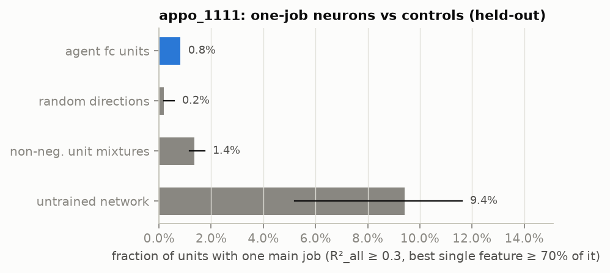
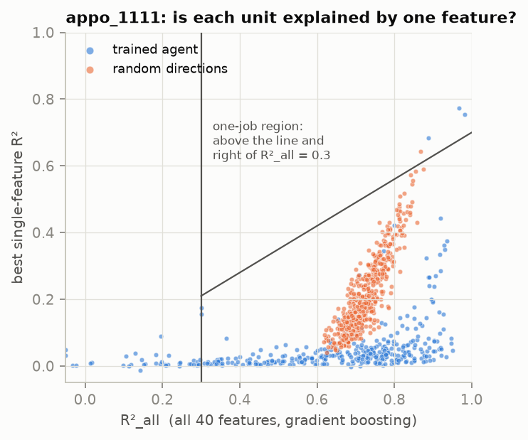
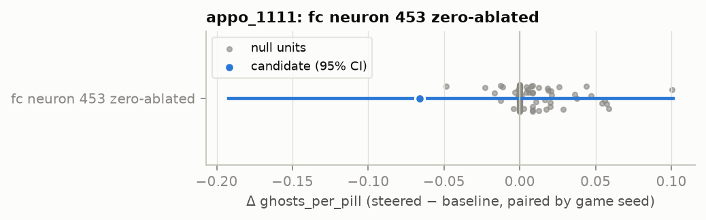
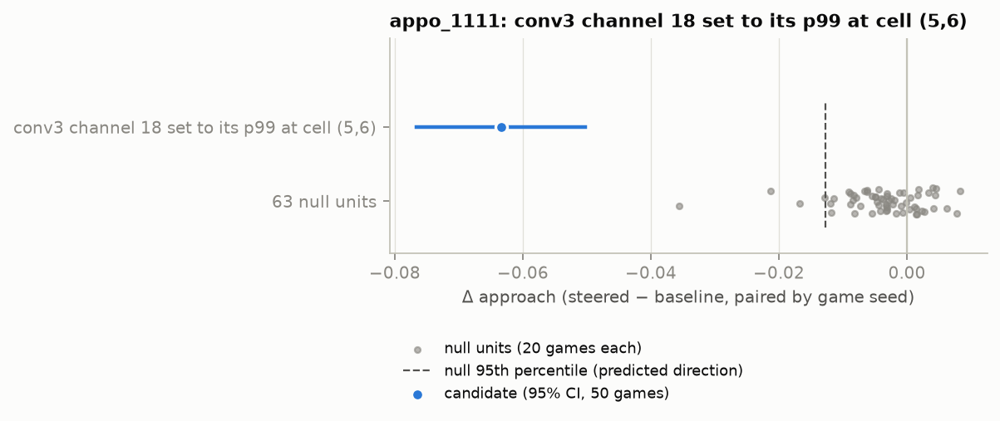
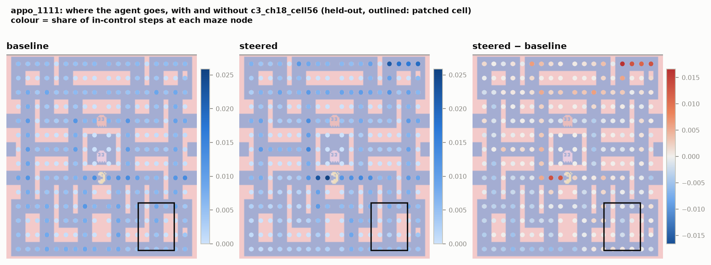

# Abstract

Goodfire's essay "Neural Networks Are Already Clean" argues that most individual neurons of trained networks have
one main job. We test this claim, and whether single units can steer behaviour, in three deep RL agents that
learned Atari Ms. Pac-Man from game reward alone. They are public Sample Factory APPO agents with a Nature-CNN torso,
trained for 2B environment steps.

We re-implement the agents in PyTorch, bit-exact against the original stack (max logit difference
<!--n:fid_logit-->1.1e-05<!--/n-->). We decode exact game state from the console RAM, including two frightened-mode
addresses that we identify (<!--n:appo_1111:edible_agree-->97.1%<!--/n--> agreement with sprite colours), and label
every unit against 40 ground-truth features under a preregistered protocol.

**Not "already clean".** On held-out games, the fraction of alive fc neurons with one main job is
<!--n:appo_1111:h1_agent-->0.8%<!--/n-->, vs <!--n:appo_1111:h1_random_dirs-->0.2%<!--/n--> for random directions and
<!--n:appo_1111:h1_untrained-->9.4%<!--/n--> for an untrained network. The preregistered privileged-basis test is
<!--n:appo_1111:h1_verdict-->supported<!--/n--> for agent 1111, but the effect is trivially small. It is
<!--n:appo_2222:h1_verdict-->not supported<!--/n--> for agent 2222 and <!--n:appo_3333:h1_verdict-->not supported<!--/n-->
for agent 3333. Neurons are instead conjunctive. Exploratorily, Ms. Pac-Man's position × heading explains a median
R² of <!--n:appo_1111:place_heading_median-->0.20<!--/n--> per neuron, vs <!--n:appo_1111:median_best_disc-->0.03<!--/n-->
for the best single feature.

**One unit, a no-go zone.** Two steering candidates were frozen before any held-out data. Setting a single conv3
unit (channel 18 at one spatial position) to its 99th percentile makes the agent avoid the corresponding maze
region: approach rate <!--n:appo_1111:c3_ch18_cell56:base-->0.424<!--/n--> →
<!--n:appo_1111:c3_ch18_cell56:arm-->0.361<!--/n-->, Holm p <!--n:appo_1111:c3_ch18_cell56:p-->0.0002<!--/n-->. This
effect is stronger than that of each of the 63 other channels at that position (the preregistered H2 passes).
Ablating fc neuron 453, a "chase the edible ghost upward" unit, cuts that specific behaviour but does not
significantly reduce ghosts eaten per power pill (H2 fails for this candidate).

**Replication.** Frozen selection rules applied to the other two agents give the following (H3):

- no-go-zone rule: <!--n:h3:c3_ch18_cell56-->replicates<!--/n-->;
- ghost-hunting ablation rule: <!--n:h3:fc453_ablate-->does not replicate<!--/n-->.

All tests, deviations and negative results are reported.

# 1. Introduction

**Motivation.** Mechanistic interpretability asks whether the internal units of a network can be read as
human-understandable variables and whether manipulating them changes behaviour in the predicted way.

**The claim we test.** Goodfire recently argued that most neuron poles of large vision and language models "have
one main job", based on top-activating examples, feature visualisation and steering
[(Cammarata/Goodfire 2026)](https://already-clean.goodfire.com/).

**Why RL is a sharp test.** Reinforcement-learning agents trained from reward alone offer two advantages:

- the environment state is fully known (for Atari, the console RAM);
- behaviour can be measured causally in closed loop.

**Gap in prior work.** Prior interpretability work on Ms. Pac-Man used:

- input saliency [(Greydanus et al. 2018)](https://arxiv.org/abs/1711.00138);
- attention maps [(Mott et al. 2019)](https://arxiv.org/abs/1906.02500);
- NMF concepts [(Bekkemoen & Langseth 2025)](https://mlanthology.org/mlj/2025/bekkemoen2025mlj-interpretable);
- a sparse autoencoder without interventions
  [(DuPlessie 2024)](https://math.mit.edu/research/highschool/primes/materials/2024/DuPlessie.pdf).

Single-channel steering of RL agents has been shown for a Procgen maze agent
[(Mini, Turner et al. 2023)](https://arxiv.org/abs/2310.08043) and for Sokoban planners
[(Taufeeque et al. 2024](https://arxiv.org/abs/2407.15421); [Bush et al. 2025)](https://arxiv.org/abs/2504.01871).
To our knowledge, no published work has steered individual neurons of a reward-trained Ms. Pac-Man agent.

**Contributions.**

1. A bit-exact, dependency-light re-implementation of the public Sample Factory Ms. Pac-Man agents with a golden
   fidelity test.
2. RAM ground truth for Ms. Pac-Man, including the frightened-mode timer `ram[116]` and per-ghost edible bits
   (bit 7 of `ram[1+i]`), and a maze lattice graph.
3. A preregistered Goodfire-style audit of every fc neuron against three controls (H1).
4. Preregistered causal steering tests with matched random-unit nulls on held-out games (H2), with replication
   rules for two more agents (H3).

# 2. Background and related work

- **Neuron-level interpretability.**
  - Circuits [(Olah et al. 2020)](https://distill.pub/2020/circuits/zoom-in/).
  - Polysemanticity and superposition, which motivate dictionary learning
    [(Bricken et al. 2023)](https://transformer-circuits.pub/2023/monosemantic-features/index.html).
  - Goodfire's counter-argument that neurons are mostly clean [(2026)](https://already-clean.goodfire.com/).
- **RL interpretability.**
  - An Atari model zoo with activation analysis [(Such et al. 2019)](https://arxiv.org/abs/1812.07069).
  - CoinRun attribution and model editing [(Hilton et al. 2020)](https://distill.pub/2020/understanding-rl-vision/).
  - Probe-based steering of planning in Sokoban [(Bush et al. 2025)](https://arxiv.org/abs/2504.01871).
- **Ground truth for Atari.**
  - AtariARI RAM annotations [(Anand et al. 2019)](https://arxiv.org/abs/1906.08226).
  - OCAtari object extraction [(Delfosse et al. 2023)](https://arxiv.org/abs/2306.08649).
- **Evaluation protocol.** Sticky actions [(Machado et al. 2018)](https://arxiv.org/abs/1709.06009).

# 3. Method

## 3.1 Agents and fidelity

- **Agents.** `edbeeching/atari_2B_atari_mspacman_{1111,2222,3333}`:
  - Sample Factory 2.0 APPO, 2B env steps, clipped reward, γ = 0.99, no RNN;
  - Nature-CNN torso (conv 32/64/64) → fc 512 ReLU → linear policy (9 actions) and value heads.
- **Environment.** The wrapper chain is `MsPacmanNoFrameskip-v4` → no-op reset → max-and-skip 4 → episodic life →
  reward clipping → 84×84 grayscale → stack 4.
- **Fidelity.** We reproduce the wrapper chain and network in PyTorch and verify both against a golden trajectory
  generated with sample-factory 2.0.3, gym 0.26.2 and ale-py 0.8.1:
  - 0 mismatched observations in <!--n:fid_steps-->446<!--/n--> steps;
  - max logit difference <!--n:fid_logit-->1.1e-05<!--/n-->.

  Appendix A has the details.

## 3.2 Ground truth

- **RAM decoding** follows OCAtari and AtariARI.
- **Frightened mode** was identified by correlating RAM bytes with blue ghost pixels and power-pill events.
- **Maze.** A 14×18 lattice graph built from the frame gives breadth-first-search distances and directions.
- **Features.** 40 features in five families (Appendix B). Steps where Ms. Pac-Man does not move (death animation,
  ready screen, level transition) are excluded.

## 3.3 Data and stochasticity

- **Splits.** 100 discovery games (seeds 0–99) and 100 held-out games (seeds 10000–10099) per agent.
- **Action sampling.** Actions are sampled from the policy with a per-game RNG, so steered and baseline games share
  random numbers.
- **Stochasticity fallback.** A preregistered check found that without sticky actions, same-start games stayed
  identical for a median of <!--n:appo_1111:div_nosticky-->1230<!--/n--> steps. The preregistered fallback (sticky
  actions, p = 0.25) was therefore used for all data (median divergence
  <!--n:appo_1111:div_sticky-->320<!--/n--> steps).

## 3.4 Audit (H1)

- **Per-unit score.** For each alive fc unit (positive pole = post-ReLU activation):
  - R²₁, the out-of-sample R² of 20-bin means of each single feature;
  - R²_all, the out-of-sample R² of gradient boosting on all features.
- **One-job criterion.** R²_all ≥ 0.3 and max R²₁ ≥ 0.7 · R²_all.
- **Controls.**
  - (a) random orthonormal directions;
  - (b) non-negative mixtures of 2–8 units;
  - (c) an untrained, orthogonally initialised network on the same states.
- **Test.** Game-cluster bootstrap of the difference in one-job fraction. H1 is supported if the 95% CI against
  (a) excludes 0.

## 3.5 Steering (H2) and replication (H3)

- **Why intervene upstream of fc.** Because the heads are linear and there is no recurrence:
  - clamping an fc unit only adds a constant action bias;
  - ablating it removes a state-dependent vote;
  - conv3 interventions act through 512 ReLUs.
- **Candidate selection** (discovery data only):
  1. Exact open-loop screens, using a rank-1 update for single conv3 units.
  2. Closed-loop pilots on discovery seeds.
  3. Two candidates frozen in a committed addendum.
- **Confirmatory design** (held-out seeds):
  - 100 baseline games, 50 games per candidate, and 20 games per null unit;
  - nulls: 99 random alive fc units, or the 63 other conv3 channels at the same cell;
  - pass criteria: predicted sign with Holm-corrected paired sign-flip p < 0.05, **and** an effect beyond the 95th
    percentile of the null.
- **Replication (H3).** Deterministic selection rules transfer the procedure to agents 2222 and 3333.

# 4. Results

## 4.1 Fidelity and ground truth
<!-- BEGIN:fidelity -->
| check | value |
|---|---|
| golden trajectory steps (incl. 2 life losses and game over) | 446 |
| steps with any observation pixel mismatch | 0 |
| max abs. logit difference | 1.1e-05 |
| max abs. value difference | 4.8e-07 |
| reference stack | sample-factory 2.0.3, gym 0.26.2, ale-py 0.8.1, torch 1.13.1 (WSL) |
<!-- END:fidelity -->

<!-- BEGIN:ground_truth_appo_1111 -->
| validation (discovery games, sticky actions) | value |
|---|---|
| agent steps checked | 161995 (100 games) |
| RAM edible bit (bit 7 of ram[1+i]) vs blue sprite pixels, per ghost-step | 97.1% |
| frightened timer ram[116] > 0 vs any ghost edible | 100.0% |
| eaten pellets at Ms. Pac-Man's lattice node (26825 events) | 100.0% |
| steps in control (moving; excludes death, ready and level transitions) | 85.1% |
| distinct maze layouts seen | 4 |
<!-- END:ground_truth_appo_1111 -->

## 4.2 H1: one-job neurons
<!-- BEGIN:h1_appo_1111 -->
| unit set (held-out, confirmatory) | units | one-job fraction [95% CI] | median R²_all | median best single R² |
|---|---|---|---|---|
| trained agent (fc units) | 367 | 0.8% [0.8%, 0.8%] | 0.708 | 0.031 |
| random directions (control a) | 512 | 0.2% [0.2%, 0.6%] | 0.719 | 0.185 |
| non-negative unit mixtures (control b) | 512 | 1.4% [1.2%, 1.8%] | 0.720 | 0.053 |
| untrained network (control c) | 499 | 9.4% [5.2%, 11.6%] | 0.537 | 0.096 |

H1 test (agent minus random directions): 0.6% [0.2%, 0.6%]; H1 supported.
<!-- END:h1_appo_1111 -->

Exploratory conjunctions (not preregistered):

<!-- BEGIN:conjunctions_appo_1111 -->
| explanatory variable(s) (exploratory, post hoc) | median R² | units with R² > 0.3 | units with R² > 0.5 |
|---|---|---|---|
| place (lattice node) | 0.127 | 11.7% | 2.5% |
| place x heading | 0.202 | 30.5% | 7.4% |
| place x frightened | 0.165 | 23.4% | 6.0% |
| pellets left (20 bins) x frightened | 0.022 | 2.7% | 1.1% |
| danger distance (20 bins) x danger direction | 0.018 | 0.3% | 0.0% |
<!-- END:conjunctions_appo_1111 -->

## 4.3 H2: steering
<!-- BEGIN:steer_appo_1111 -->
| intervention | primary metric (predicted sign) | baseline → steered | Δ [95% CI] | Holm p | above null 95th pct? | H2 |
|---|---|---|---|---|---|---|
| fc neuron 453 zero-ablated | ghosts_per_pill (−) | 0.294 → 0.228 | -0.066 [-0.192, 0.101] | 0.2280 | yes (null q95 0.013) | fail |
| conv3 channel 18 set to its p99 at cell (5,6) | approach (−) | 0.424 → 0.361 | -0.063 [-0.077, -0.050] | 0.0002 | yes (null q95 0.013) | pass |
| fc neuron 188 clamped to its p99 (constant logit bias, DLA UP -0.70) (positive control) | action_given_trigger (−) | 0.395 → 0.305 | -0.090 [-0.102, -0.079] | – | – | – |
<!-- END:steer_appo_1111 -->

Off-target effects:

<!-- BEGIN:offtarget_appo_1111 -->
| intervention | Δ return | Δ deaths / 1k steps | Δ pellets / 1k steps | Δ ghosts per pill |
|---|---|---|---|---|
| fc neuron 453 zero-ablated | -1619 [-2194, -1056] | 1.14 [0.75, 1.52] | -9.23 [-17.68, -0.84] | -0.07 [-0.19, 0.10] |
| conv3 channel 18 set to its p99 at cell (5,6) | -2490 [-2990, -2005] | 4.17 [3.27, 5.14] | -12.16 [-20.78, -3.83] | -0.05 [-0.18, 0.09] |
<!-- END:offtarget_appo_1111 -->

Discovery-phase evidence that led to the candidates (exploratory):

<!-- BEGIN:screen_appo_1111 -->
| rank | conv3 channel @ cell | Δ P(move toward cell) at junctions | dose (p99) |
|---|---|---|---|
| repel 1 | ch 18 @ (5, 6) | -5.8 pp | 24.6 |
| repel 2 | ch 15 @ (0, 6) | -5.1 pp | 27.2 |
| repel 3 | ch 40 @ (4, 6) | -4.0 pp | 34.8 |
| repel 4 | ch 36 @ (5, 6) | -3.6 pp | 22.7 |
| repel 5 | ch 58 @ (5, 6) | -3.6 pp | 18.4 |
| attract 1 | ch 16 @ (6, 2) | +3.6 pp | 23.0 |
| attract 2 | ch 8 @ (1, 0) | +3.0 pp | 21.6 |
| attract 3 | ch 38 @ (5, 0) | +3.0 pp | 20.0 |
| attract 4 | ch 34 @ (6, 0) | +2.7 pp | 28.1 |
| attract 5 | ch 46 @ (6, 0) | +2.6 pp | 14.5 |
<!-- END:screen_appo_1111 -->

<!-- BEGIN:pilot_appo_1111 -->
| intervention (discovery pilot, paired games) | targeted metric | baseline → steered | Δ [95% CI] | Δ return | Δ deaths / 1k |
|---|---|---|---|---|---|
| `c3_ch20_ablate` | deaths_per_1k | 2.536 → 2.730 | 0.194 [-0.183, 0.671] | -210 | 0.19 |
| `c3_ch20_clamp_fright` | ghosts_per_pill | 0.392 → 0.213 | -0.179 [-0.292, -0.060] | -3668 | 5.28 |
| `c3_ch20_clamp` | deaths_per_1k | 2.536 → 9.071 | 6.535 [5.265, 7.759] | -4047 | 6.54 |
| `c3_ch39_ablate` | deaths_per_1k | 2.536 → 4.169 | 1.633 [0.646, 2.502] | -2566 | 1.63 |
| `c3_ch53_ablate` | deaths_per_1k | 2.536 → 2.665 | 0.129 [-0.035, 0.305] | -229 | 0.13 |
| `c3_ch18_cell56` | approach | 0.430 → 0.375 | -0.056 [-0.068, -0.044] | -3520 | 5.57 |
| `fc378_ablate` | action_given_trigger | 0.502 → 0.475 | -0.027 [-0.055, -0.000] | -1307 | 0.67 |
| `fc453_ablate` | action_given_trigger | 0.483 → 0.298 | -0.184 [-0.204, -0.164] | -2739 | 1.52 |
| `fc188_clamp` | action_given_trigger | 0.384 → 0.302 | -0.082 [-0.091, -0.072] | -3047 | 1.43 |
<!-- END:pilot_appo_1111 -->

## 4.4 H3: replication
<!-- BEGIN:h3 -->
| rule (frozen on agent 1111) | agent | selected unit | primary metric Δ [95% CI] | Holm p (within agent) | null units at least as strong | passes |
|---|---|---|---|---|---|---|
| zero-ablate the fc unit most needed for approaching edible ghosts | appo_2222 | fc neuron 379 zero-ablated | -0.101 [-0.167, -0.036] | 0.0025 | 0 of 99 | yes |
| zero-ablate the fc unit most needed for approaching edible ghosts | appo_3333 | fc neuron 351 zero-ablated | 0.190 [0.071, 0.301] | 0.9992 | 99 of 99 | no |
| set the most repelling conv3 (channel, cell) to its p99 | appo_2222 | conv3 channel 3 set to its p99 at cell (0, 0) | -0.034 [-0.043, -0.026] | 0.0002 | 0 of 63 | yes |
| set the most repelling conv3 (channel, cell) to its p99 | appo_3333 | conv3 channel 46 set to its p99 at cell (5, 6) | -0.216 [-0.232, -0.200] | 0.0002 | 0 of 63 | yes |
<!-- END:h3 -->

Steering per agent (held-out):

<!-- BEGIN:steer_appo_2222 -->
| intervention | primary metric (predicted sign) | baseline → steered | Δ [95% CI] | Holm p | above null 95th pct? | H2 |
|---|---|---|---|---|---|---|
| fc neuron 379 zero-ablated | ghosts_per_pill (−) | 0.463 → 0.362 | -0.101 [-0.167, -0.036] | 0.0025 | yes (null q95 0.027) | pass |
| conv3 channel 3 set to its p99 at cell (0, 0) | approach (−) | 0.430 → 0.396 | -0.034 [-0.043, -0.026] | 0.0002 | yes (null q95 0.007) | pass |
<!-- END:steer_appo_2222 -->

<!-- BEGIN:steer_appo_3333 -->
| intervention | primary metric (predicted sign) | baseline → steered | Δ [95% CI] | Holm p | above null 95th pct? | H2 |
|---|---|---|---|---|---|---|
| fc neuron 351 zero-ablated | ghosts_per_pill (−) | 0.660 → 0.850 | 0.190 [0.071, 0.301] | 0.9992 | no (null q95 0.019) | fail |
| conv3 channel 46 set to its p99 at cell (5, 6) | approach (−) | 0.440 → 0.224 | -0.216 [-0.232, -0.200] | 0.0002 | yes (null q95 0.012) | pass |
<!-- END:steer_appo_3333 -->

# 5. Discussion

**Are the neurons clean?**

- **Not under single-feature labels.** With a 40-feature dictionary of single game variables, almost no fc neuron
  of these agents has one main job, and the agents are no cleaner than random directions in a meaningful way.
- **The basis is still not arbitrary.**
  - Random directions score *higher* best-single-feature R² than neurons (Fig. R²). Dense mixtures pick up slow
    global variables such as pellets remaining.
  - Neurons are sparse (they fire on a minority of steps) and conjunctive: position × heading explains them far
    better than any single fact.
- **What the units are.** They resemble place cells more than "ghost detectors". This is consistent with saliency
  studies of Ms. Pac-Man agents, which found attention on corridors rather than ghosts
  [(Greydanus et al. 2018)](https://arxiv.org/abs/1711.00138).
- **Reconciling with Goodfire.** Goodfire's labels are free-text visual descriptions, which can express such
  conjunctions. Our result is a statement about a ground-truth *variable* basis. The conjunction analysis is post
  hoc and should be tested with a preregistered conjunctive dictionary.

**Can single units steer behaviour?**

- **Yes, causally and specifically, but not cleanly.** A single conv3 unit's activity is enough to repel the agent
  from a maze region. No other channel at that position does this at matched dose, and the same selection rule
  finds such a unit in an independently trained agent (H3).
- **Steering is destructive.** The agent abandons that region's pellets and dies more. Single-unit steering here
  is a blunt instrument, not a precise control knob.
- **Mechanism vs outcome.** The fc ablation shows a gap between mechanism and outcome. The predicted local
  behaviour ("go toward the edible ghost in direction d") changes strongly in agents 1111 and 3333. The global
  outcome (ghosts eaten per pill) changes little in agent 1111, falls in agent 2222, and *rises* in agent 3333.
  Removing one direction's vote reroutes the agent rather than simply weakening ghost hunting.
- **Why the fc layer is constrained.** The linear, recurrence-free policy head means fc-unit steering can only add
  fixed action biases. State-dependent steering must enter upstream, where activations pass through the fc ReLUs.

**Methodological lessons.**

1. Bit-exact fidelity tests are cheap and necessary. Library defaults changed under us (gymnasium's grayscale).
2. Near-deterministic policies need injected stochasticity (sticky actions) before games can serve as
   independent samples.
3. Discovery-pilot effects shrink on held-out data (winner's curse). Confirmatory effect sizes must come from
   held-out games.
4. A preregistered difference test needs a minimum effect size. Our H1 criterion was "passed" by a 0.6
   percentage-point difference.

# 6. Limitations

- **Feature dictionary.** The one-job criterion depends on a finite 40-feature dictionary of *single* variables, so
  conjunctive codes are counted as "not clean" by construction. The conjunction analysis is post hoc.
- **Sticky actions.** These change the agent's task (it was trained without them) and lower its score. All results
  describe the agent under p = 0.25.
- **Dependence between games.** Games that share a start state overlap for their first few hundred steps. We
  report a start-state-cluster bootstrap as a robustness check.
- **Scope of interventions.** Steering was tested at fixed doses (discovery p99) and only for the frozen
  intervention types; dose-response is exploratory.
- **Agents.** Three public agents of one architecture and algorithm. Generalisation to other algorithms (DQN, PPO
  with IMPALA-ResNet) is untested.

# 7. Conclusion

**Clean?** In three reward-trained Ms. Pac-Man agents, individual neurons are not "already clean" with respect to
exact single game variables. They are sparse, conjunctive, place-like codes.

**Steerable?** Yes, causally and specifically. Single units steer behaviour beyond matched random units: a single
conv3 unit creates a reproducible no-go zone, and a single fc unit gates a predicted piece of ghost-chasing. These
effects come with substantial collateral damage.

**Toolkit.** The fidelity-checked models, RAM ground truth, preregistration and microscope make these agents a
convenient testbed for future work: conjunctive dictionaries, sparse autoencoders, and other algorithms.

# Appendix A. Fidelity details
See `reports/01_fidelity.md`.

# Appendix B. Feature list
See `src/pacneuron/features.py` and `reports/02_ram_ground_truth.md`.

# Appendix C. Preregistration and deviations
See `reports/preregistration.md`, `reports/preregistration_addendum.md` and `reports/00_summary.md`.

# AI statement

This codebase and paper were written by Claude Code (Anthropic's Claude), following an exact specification from a
human author who directed the research. Human cleanup and rewriting are in progress.
