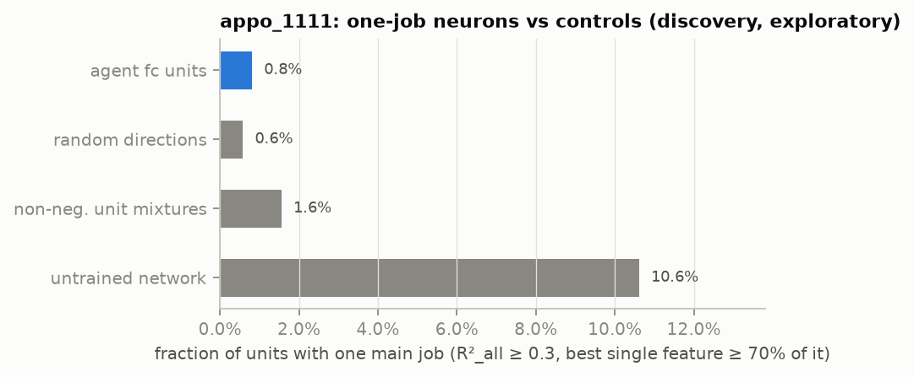

# Experiment 3: Neuron audit — do the agent's neurons have "one main job"?

## Question and hypothesis (preregistered H1)
- **Claim tested.** Goodfire argues that the neurons of trained vision and language networks are largely
  interpretable. In its preliminary Qwen3-32B audits, "roughly 90% of neuron poles have one main job"
  ([Cammarata, Goodfire 2026](https://already-clean.goodfire.com/)).
- **Prediction.** For the 512-unit fc layer of the Ms. Pac-Man agent, the fraction of alive units well explained
  by a *single* ground-truth feature is larger than for random directions of the same layer (the
  privileged-basis test), for non-negative random mixtures of units, and for an untrained network.

## Method
- **Data.** Activations of every unit at every in-control step:
  - discovery: 100 games, game seeds 0–99;
  - held-out: 100 games, seeds 10000–10099;
  - ALE sticky actions p = 0.25 (preregistered fallback, see `00_summary.md`).
- **Score per unit.**
  - R²₁ = out-of-sample R² of the unit against bin means of one feature (20 quantile bins; categories for
    heading and maze).
  - R²_all = out-of-sample R² of `HistGradientBoostingRegressor` on all 40 features.
  - A unit has **one job** if R²_all ≥ 0.3 and max R²₁ ≥ 0.7 · R²_all.
  - Positive pole = post-ReLU activation. Negative pole = the most negative pre-activations; it is shown in the
    microscope but cannot be steered (the ReLU removes it).
- **Controls.**
  - (a) 512 random orthonormal directions of the post-ReLU fc space;
  - (b) 512 non-negative Dirichlet mixtures of 2–8 alive units;
  - (c) the alive fc units of an orthogonally initialised untrained network evaluated on the same states. It uses
    init seed 0 for every agent (identical weights across agents) and that agent's own observation normaliser.
- **Statistics.** Game-cluster bootstrap of the difference in one-job fraction: 10,000 resamples for H1, 2,000 for
  the exploratory audit. The fitted models are fixed and only the scored games are resampled. A robustness bootstrap
  over start-state clusters (2,000 resamples) is added.
- **Splits.** Exploratory: fit on even discovery games, score on odd ones. Confirmatory: fit on all discovery
  games, score on held-out games.

## Exploratory audit (discovery split-half)
<!-- BEGIN:audit_appo_1111 -->
| unit set (discovery split-half, exploratory) | units | one-job fraction [95% CI] | median R²_all | median best single R² |
|---|---|---|---|---|
| trained agent (fc units) | 367 | 0.8% [CI not computed in this run] | 0.717 | 0.029 |
| random directions (control a) | 512 | 0.6% [CI not computed in this run] | 0.720 | 0.187 |
| non-negative unit mixtures (control b) | 512 | 1.6% [CI not computed in this run] | 0.733 | 0.051 |
| untrained network (control c) | 499 | 10.6% [CI not computed in this run] | 0.534 | 0.092 |
<!-- END:audit_appo_1111 -->

## Confirmatory H1 (held-out games)
<!-- BEGIN:h1_appo_1111 -->
| unit set (held-out, confirmatory) | units | one-job fraction [95% CI] | median R²_all | median best single R² |
|---|---|---|---|---|
| trained agent (fc units) | 367 | 0.8% [0.8%, 0.8%] | 0.708 | 0.031 |
| random directions (control a) | 512 | 0.2% [0.2%, 0.6%] | 0.719 | 0.185 |
| non-negative unit mixtures (control b) | 512 | 1.4% [1.2%, 1.8%] | 0.720 | 0.053 |
| untrained network (control c) | 499 | 9.4% [5.2%, 11.6%] | 0.537 | 0.096 |

H1 test (agent minus random directions): 0.6% [0.2%, 0.6%]; H1 supported.
<!-- END:h1_appo_1111 -->

Robustness (preregistered: start-state-cluster bootstrap; threshold sensitivity). The tiny H1 advantage is **not
robust to the threshold choice**. With the ratio threshold at 0.5 instead of 0.7 (R²_all ≥ 0.3), random directions
score <!--n:appo_1111:sweep_0.3_0.5:random_dirs-->8.0%<!--/n--> vs the agent's
<!--n:appo_1111:sweep_0.3_0.5:agent-->1.4%<!--/n-->:
<!-- BEGIN:h1robust_appo_1111 -->
| unit set | one-job fraction | game-bootstrap 95% CI | start-state-cluster 95% CI |
|---|---|---|---|
| trained agent (fc units) | 0.8% | [0.8%, 0.8%] | [0.8%, 0.8%] |
| random directions (control a) | 0.2% | [0.2%, 0.6%] | [0.2%, 0.4%] |
| non-negative unit mixtures (control b) | 1.4% | [1.2%, 1.8%] | [1.4%, 2.0%] |
| untrained network (control c) | 9.4% | [5.2%, 11.6%] | [4.8%, 11.0%] |

Threshold sweep, one-job fraction shown as agent / random directions (rows: R²_all threshold; columns: best-single / R²_all ratio threshold). Start-state clusters: 4.

| R²_all ≥ | ratio ≥ 0.5 | 0.6 | 0.7 | 0.8 | 0.9 |
|---|---|---|---|---|---|
| 0.1 | 1.6% / 8.0% | 0.8% / 1.6% | 0.8% / 0.2% | 0.0% / 0.0% | 0.0% / 0.0% |
| 0.2 | 1.6% / 8.0% | 0.8% / 1.6% | 0.8% / 0.2% | 0.0% / 0.0% | 0.0% / 0.0% |
| 0.3 | 1.4% / 8.0% | 0.8% / 1.6% | 0.8% / 0.2% | 0.0% / 0.0% | 0.0% / 0.0% |
| 0.4 | 1.1% / 8.0% | 0.8% / 1.6% | 0.8% / 0.2% | 0.0% / 0.0% | 0.0% / 0.0% |
| 0.5 | 1.1% / 8.0% | 0.8% / 1.6% | 0.8% / 0.2% | 0.0% / 0.0% | 0.0% / 0.0% |
<!-- END:h1robust_appo_1111 -->

## Exploratory follow-up: conjunctions (post hoc, discovery split-half)
Units are well predicted by all features together but not by any single one. So we asked which *pairs* of
variables explain them, using joint bins on the maze lattice:

<!-- BEGIN:conjunctions_appo_1111 -->
| explanatory variable(s) (exploratory, post hoc) | median R² | units with R² > 0.3 | units with R² > 0.5 |
|---|---|---|---|
| place (lattice node) | 0.127 | 11.7% | 2.5% |
| place x heading | 0.202 | 30.5% | 7.4% |
| place x frightened | 0.165 | 23.4% | 6.0% |
| pellets left (20 bins) x frightened | 0.022 | 2.7% | 1.1% |
| danger distance (20 bins) x danger direction | 0.018 | 0.3% | 0.0% |
<!-- END:conjunctions_appo_1111 -->

All R² values here are out-of-sample (fit on even games, score on odd ones), but bin counts differ. Place (the
lattice node, a joint x × y variable) has up to 252 bins and place × heading up to 1,008, while each single feature
has ≤ 20.
- Ms. Pac-Man's lattice node alone already beats every single feature, and adding her heading raises the median
  further.
- Many fc neurons therefore look like **place × heading cells** (cf. hippocampal place cells). Gradient boosting on
  all 40 features still explains far more (median <!--n:appo_1111:median_all_disc-->0.72<!--/n-->).
- Ghost-related variables, even as conjunctions, explain little.
- This is reminiscent of [Greydanus et al. 2018](https://arxiv.org/abs/1711.00138), where several partially trained
  A3C Ms. Pac-Man agents "appeared to be tracking corridors" rather than the ghosts. Attention agents in
  [Mott et al. 2019](https://arxiv.org/abs/1906.02500), by contrast, scan the paths ahead for ghosts.

This analysis was not preregistered and is evidence for a hypothesis to test, not a confirmed claim.

## conv3 channels
- **Test.** Within-cell AUROC of each channel for the presence of each object type in its receptive-field core.
  Location is controlled by comparing only within a cell.
- **Result.** It is weak for every channel (best <!--n:appo_1111:c3_best_obj-->0.63 (channel 24, player)<!--/n-->; see the microscope site).
  conv3 channels are not clean object detectors.
- **Global states.** Some channels track global game states better. Channel 20's spatial mean is lower when ghosts
  are edible (AUROC <!--n:appo_1111:c3_ch20_frightened-->0.25<!--/n--> for frightened mode) and higher when a
  dangerous ghost is near (<!--n:appo_1111:c3_ch20_n_danger_near-->0.65<!--/n-->); exploratory, from
  `results/conv3_states_appo_1111.json`.

## Learnings
- Under a 40-feature, single-variable dictionary, the neurons of this reward-trained agent are **not** "already
  clean". The exploratory analysis suggests they are conjunctive. Goodfire's free-text visual labels can name
  conjunctions of properties; a RAM-feature dictionary needs conjunctions to compete.
- Pellets left is the best single feature for <!--n:appo_1111:best_feat_pellets:random_dirs-->472 of 512<!--/n-->
  random directions but only <!--n:appo_1111:best_feat_pellets:agent-->155 of 367<!--/n--> neurons (discovery
  split-half, `results/claim_checks_appo_1111.json`). Dense mixtures pick up this slow global variable, which is why
  random directions have a higher best single-feature R².
- Alive units are sparse: the median one is active on <!--n:appo_1111:median_active-->1.0%<!--/n--> of in-control
  steps.
- <!--n:appo_1111:dead-->145<!--/n--> of 512 fc units are active on fewer than 0.1% of in-control discovery steps (the
  preregistered alive rule); <!--n:appo_1111:never_fire-->39<!--/n--> of them never fire. They are excluded from H1. The
  microscope shows only alive units; the others are listed as `dead_units` in `site/data/*.json`.
