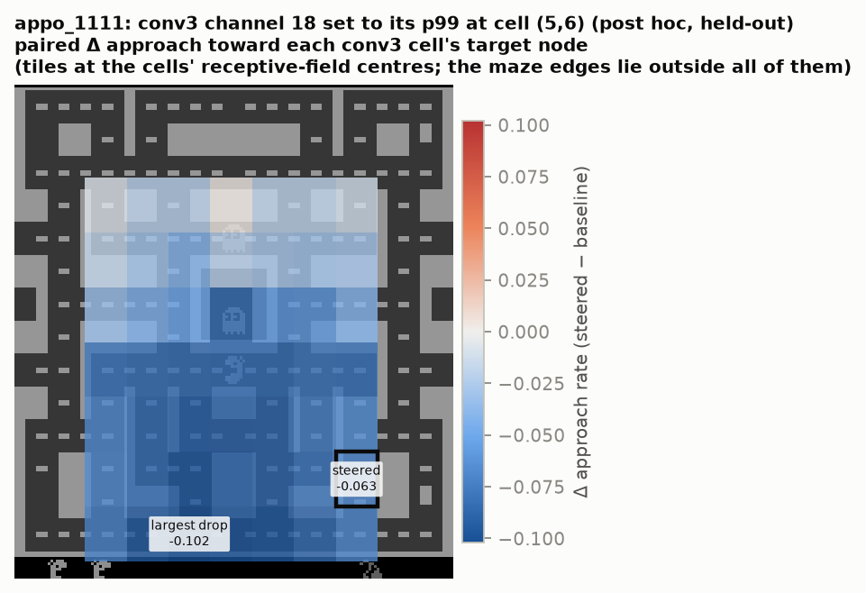
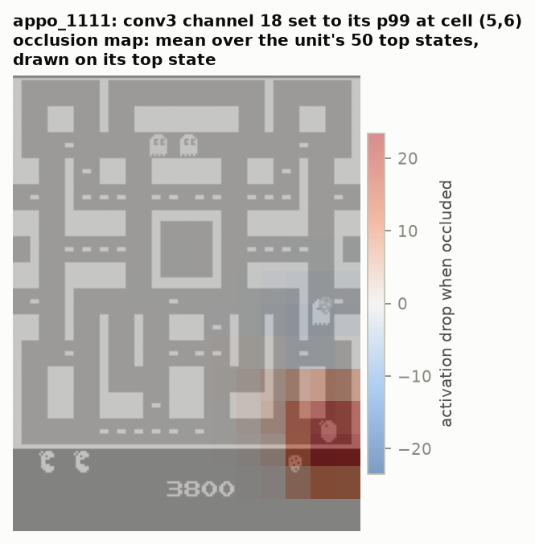
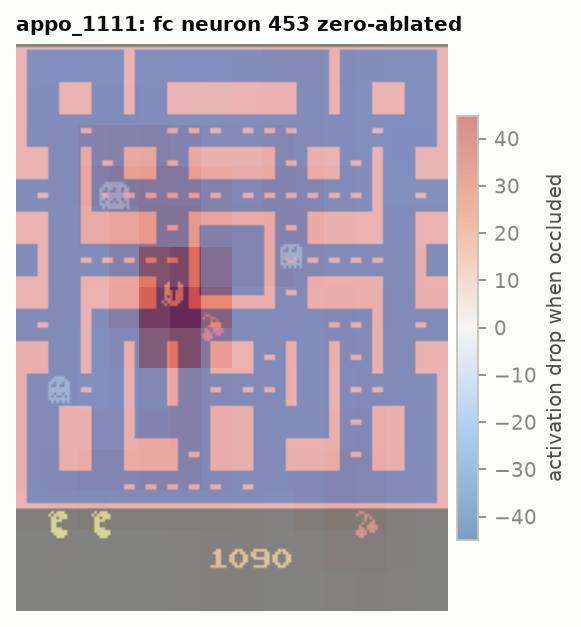

# Experiment 4: Steering single neurons and channels (preregistered H2)

## Question
Is there a neuron or channel whose steering changes the agent's behaviour in a specific, predicted way, beyond
what matched random units do?

## Structural fact that shapes the design
The agent has no RNN, and its policy head is linear on the 512 fc units. So for an fc unit n:
- **Clamping** it to v shifts the logits by exactly (v − h_n(s)) · W_π[:, n]
  (`tests/test_model.py::test_fc_clamp_equals_logit_bias`). This replaces the unit's state-dependent vote
  h_n(s)·W_π[:, n] with the constant v·W_π[:, n], which is a constant bias wherever the unit is inactive.
- **Ablating** it removes a state-dependent vote: whatever the unit adds when it fires.

Steering *upstream*, in conv3 (64 channels × 7×7 cells), acts through 512 ReLUs, so its effect can depend on the
state. Setting a single conv3 unit is an exact rank-1 update of the fc pre-activations
(`tests/test_model.py::test_rank1_conv3_patch_matches_full_forward`). This makes an open-loop screen of all
64 × 49 patches cheap.

## Discovery phase (exploratory, used only to choose candidates)
1. **Open-loop patch screen.** Each (channel, cell) is set to its discovery p99. We measure the change in the
   probability of moving toward that cell's maze location at junctions, on 4,000 recorded discovery states.
   <!-- BEGIN:screen_appo_1111 -->
| rank | conv3 channel @ cell | Δ P(move toward cell) at junctions | dose (p99) |
|---|---|---|---|
| repel 1 | ch 18 @ (5, 6) | -5.8 pp | 24.6 |
| repel 2 | ch 15 @ (0, 6) | -5.1 pp | 27.2 |
| repel 3 | ch 40 @ (4, 6) | -4.0 pp | 34.8 |
| repel 4 | ch 36 @ (5, 6) | -3.6 pp | 22.7 |
| repel 5 | ch 58 @ (5, 6) | -3.6 pp | 18.4 |
| attract 1 | ch 16 @ (6, 2) | +3.6 pp | 23.0 |
| attract 2 | ch 8 @ (1, 0) | +3.0 pp | 21.6 |
| attract 3 | ch 38 @ (5, 0) | +3.0 pp | 20.0 |
| attract 4 | ch 34 @ (6, 0) | +2.7 pp | 28.1 |
| attract 5 | ch 46 @ (6, 0) | +2.6 pp | 14.5 |
<!-- END:screen_appo_1111 -->
2. **fc ablation screen.** Zero each unit and measure the change in P(move toward the nearest edible ghost /
   dangerous ghost / pellet). The top unit for edible ghosts is fc 453. Its best direction feature is "nearest
   edible ghost is up" (its best feature overall is pellets left), and it votes for UP.
3. **Closed-loop pilots** on discovery seeds 0–29, paired with the unsteered discovery games of the same seeds:
   <!-- BEGIN:pilot_appo_1111 -->
| intervention (discovery pilot, paired games) | targeted metric | baseline → steered | Δ [95% CI] | Δ return | Δ deaths / 1k |
|---|---|---|---|---|---|
| `c3_ch20_ablate` | deaths_per_1k | 2.536 → 2.730 | 0.194 [-0.183, 0.671] | -210 | 0.19 |
| `c3_ch20_clamp_fright` | ghosts_per_pill | 0.392 → 0.213 | -0.179 [-0.292, -0.060] | -3668 | 5.28 |
| `c3_ch20_clamp` | deaths_per_1k | 2.536 → 9.071 | 6.535 [5.265, 7.759] | -4047 | 6.54 |
| `c3_ch39_ablate` | deaths_per_1k | 2.536 → 4.169 | 1.633 [0.646, 2.502] | -2566 | 1.63 |
| `c3_ch53_ablate` | deaths_per_1k | 2.536 → 2.665 | 0.129 [-0.035, 0.305] | -229 | 0.13 |
| `c3_ch18_cell56` | approach | 0.430 → 0.375 | -0.056 [-0.068, -0.044] | -3520 | 5.57 |
| `fc378_ablate` | action_given_trigger | 0.502 → 0.475 | -0.027 [-0.055, -0.000] | -1307 | 0.67 |
| `fc453_ablate` | action_given_trigger | 0.483 → 0.298 | -0.184 [-0.204, -0.164] | -2739 | 1.52 |
| `fc188_clamp` | action_given_trigger | 0.384 → 0.302 | -0.082 [-0.091, -0.072] | -3047 | 1.43 |
<!-- END:pilot_appo_1111 -->
4. Frozen candidates and nulls: `reports/preregistration_addendum.md`, `results/candidates.json`.

## Confirmatory results (held-out seeds; paired by game seed)
<!-- BEGIN:steer_appo_1111 -->
| intervention | primary metric (predicted sign) | baseline → steered | Δ [95% CI] | Holm p | above null 95th pct? | H2 |
|---|---|---|---|---|---|---|
| fc neuron 453 zero-ablated | ghosts_per_pill (−) | 0.294 → 0.228 | -0.066 [-0.192, 0.101] | 0.2280 | yes (null q95 0.013) | fail |
| conv3 channel 18 set to its p99 at cell (5,6) | approach (−) | 0.424 → 0.361 | -0.063 [-0.077, -0.050] | 0.0002 | yes (null q95 0.013) | pass |
| fc neuron 188 clamped to its p99 (constant logit bias, DLA UP -0.70) (positive control) | action_given_trigger (−) | 0.395 → 0.305 | -0.090 [-0.102, -0.079] | – | – | – |

p = 0.0001 is the smallest attainable value of the 10,000-permutation sign-flip test (1/10,001); 0.0002 is that floor after Holm over 2 tests, so it means p ≤ that value. The positive control's frozen label says "constant logit bias": clamping unit n to v shifts the logits by (v − h_n(s))·W_π[:, n], which is constant only on steps where the unit is inactive (fc 188: active on 2.1% of in-control discovery steps).
<!-- END:steer_appo_1111 -->

Off-target effects, i.e. how much else changes (preregistration §6 criterion 3: paired Δ [95% CI], two-sided
sign-flip test, Benjamini-Hochberg across all off-target tests of the agent):
<!-- BEGIN:offtarget_appo_1111 -->
| intervention | off-target metric | Δ [95% CI] | two-sided p | BH q |
|---|---|---|---|---|
| fc neuron 453 zero-ablated | return | -1619 [-2194, -1056] | 0.0001 | 0.0001 |
| fc neuron 453 zero-ablated | deaths_per_1k | 1.14 [0.75, 1.52] | 0.0001 | 0.0001 |
| fc neuron 453 zero-ablated | pellets_per_1k | -9.23 [-17.68, -0.84] | 0.0416 | 0.0468 |
| fc neuron 453 zero-ablated | in_control | -469 [-633, -304] | 0.0001 | 0.0001 |
| conv3 channel 18 set to its p99 at cell (5,6) | return | -2490 [-2990, -2005] | 0.0001 | 0.0001 |
| conv3 channel 18 set to its p99 at cell (5,6) | deaths_per_1k | 4.17 [3.27, 5.14] | 0.0001 | 0.0001 |
| conv3 channel 18 set to its p99 at cell (5,6) | pellets_per_1k | -12.16 [-20.78, -3.83] | 0.0071 | 0.0091 |
| conv3 channel 18 set to its p99 at cell (5,6) | ghosts_per_pill | -0.05 [-0.18, 0.09] | 0.5156 | 0.5156 |
| conv3 channel 18 set to its p99 at cell (5,6) | in_control | -788 [-944, -633] | 0.0001 | 0.0001 |

p = 0.0001 is the smallest attainable value of the 10,000-permutation sign-flip test (1/10,001), so it means p ≤ that value.
<!-- END:offtarget_appo_1111 -->

Secondary mechanistic metric for fc 453: P(UP-ish action | nearest edible ghost is up)
<!--n:appo_1111:fc453_ablate:sec-->0.505 → 0.315 (Δ -0.190 [-0.209, -0.171])<!--/n-->.

Videos (left: unsteered, right: steered, same game seed and sticky-action RNG):
- `figures/video_appo_1111_fc453_ablate.mp4`
- `figures/video_appo_1111_c3_ch18_cell56.mp4`, with the patched cell outlined.

## Interpretation (agent 1111)

### conv3 channel 18 at cell (5,6): passes H2, but the effect is broad disruption, not a local "no-go zone"
- **The intervention.** Writing the unit's own 99th-percentile activation into one position of one conv3 channel.
  The unit's 36×36-pixel receptive field (of the 84×84 input) covers the lower right of the maze. The video and the
  occupancy figure outline its central 16×16-pixel core.
- **The preregistered effect.** The agent moves toward that cell's target node less often:
  - approach rate <!--n:appo_1111:c3_ch18_cell56:base-->0.424<!--/n--> →
    <!--n:appo_1111:c3_ch18_cell56:arm-->0.361<!--/n-->, Δ <!--n:appo_1111:c3_ch18_cell56:delta-->-0.063 [-0.077, -0.050]<!--/n-->;
  - Holm p <!--n:appo_1111:c3_ch18_cell56:p-->0.0002<!--/n-->.
- **The preregistered null.** The other <!--n:appo_1111:c3_ch18_cell56:null_n-->63<!--/n--> channels, set to *their*
  99th percentile at the same position, barely change approach (mean Δ
  <!--n:appo_1111:c3_ch18_cell56:null_mean-->-0.004<!--/n-->), and
  <!--n:appo_1111:c3_ch18_cell56:null_ge-->0<!--/n--> of them reach channel 18's effect. H2 therefore passes as
  preregistered.
- **Post-hoc specificity checks (audit of 2026-11-01, same held-out games; table below).** They change how the pass
  should be read:
  - *The drop is not local.* Computed for the target node of every one of the 49 conv3 cells, the steered cell's
    drop ranks <!--n:appo_1111:c3_ch18_cell56:spec_rank-->28 of 49<!--/n--> (1 = largest drop). The median cell drops
    by <!--n:appo_1111:c3_ch18_cell56:spec_median-->-0.068<!--/n-->: the agent approaches almost every part of the maze
    less often.
  - *The agent does not leave the steered region.* Its share of time in the steered cell's
    <!--n:appo_1111:c3_ch18_cell56:spec_quad-->bottom-right<!--/n--> quadrant goes
    <!--n:appo_1111:c3_ch18_cell56:spec_region:bottom-right-->0.268 → 0.254<!--/n-->. The most vacated quadrant is the
    <!--n:appo_1111:c3_ch18_cell56:spec_vacated-->bottom-left<!--/n-->
    (<!--n:appo_1111:c3_ch18_cell56:spec_region:bottom-left-->0.264 → 0.182<!--/n-->). Time within 3 steps of the
    target node changes <!--n:appo_1111:c3_ch18_cell56:spec_near-->0.062 → 0.057 (-9%)<!--/n--> (rank
    <!--n:appo_1111:c3_ch18_cell56:spec_near_rank-->20 of 49<!--/n-->).
  - *The null is weaker, not just different.* Channel 18 has the largest open-loop KL of the 64 channels at that cell
    (rank <!--n:appo_1111:c3_ch18_cell56:spec_kl_rank-->1 of 64<!--/n-->,
    <!--n:appo_1111:c3_ch18_cell56:spec_kl_ratio-->10×<!--/n--> the median of the others). Its return loss exceeds that of
    <!--n:appo_1111:c3_ch18_cell56:spec_damage-->100.0% of its 63 null units<!--/n--> (seeds 10000–10019). The
    preregistered null matched the dose *rule*, not the strength of the perturbation.
  - *Navigation degrades.* The action-change rate goes
    <!--n:appo_1111:c3_ch18_cell56:spec_change-->0.483 → 0.565<!--/n--> and the 8-step net displacement goes
    <!--n:appo_1111:c3_ch18_cell56:spec_disp-->2.23 → 1.97<!--/n--> lattice steps. The agent dithers more. Life-loss
    windows do not explain the drop (Δ without them
    <!--n:appo_1111:c3_ch18_cell56:spec_excl_loss-->-0.065<!--/n-->).
  - *Reading.* The result is causal: the strongest single-cell perturbation found by the screen reliably changes
    behaviour on held-out games. It is not evidence that the unit encodes, or creates, a no-go zone at its own location.
- **Consequences.** Overall play gets worse. We did not measure pellets per maze region, only per game:
  - deaths per 1k in-control steps Δ <!--n:appo_1111:c3_ch18_cell56:deaths_per_1k-->4.2 [3.3, 5.1]<!--/n-->;
  - pellets per 1k in-control steps Δ <!--n:appo_1111:c3_ch18_cell56:pellets_per_1k-->-12.2 [-20.8, -3.8]<!--/n-->;
  - return Δ <!--n:appo_1111:c3_ch18_cell56:return-->-2490 [-2990, -2005]<!--/n-->.
- **What it does not show.** That channel 18 "means" danger. Its location-controlled object AUROCs are near chance
  (see the audit). Its strongest activations do coincide with Ms. Pac-Man being in its receptive field: she is within
  12 px of its occlusion peak in <!--n:appo_1111:c3_ch18_cell56:near_peak-->98.0% of its 50 top states<!--/n-->
  (exploratory). The result is causal and behavioural, but not local (post-hoc checks above). The semantic label
  remains open.
- **Prior work.** In a Procgen maze agent, modifying channels that encode the goal's position could "partially
  control the policy" toward a chosen goal location ([Mini et al. 2023](https://arxiv.org/abs/2310.08043)). Our
  conv3 patch was selected to repel from a location, but post hoc it shows no comparably targeted effect in agent 1111.

Post-hoc specificity checks, agent 1111 (exploratory, same held-out games):

<!-- BEGIN:specificity_appo_1111 -->
| conv3 candidate (post hoc) | Δ approach, steered cell (rank of 49, 1 = largest drop) | median Δ over all 49 cells | time within 3 steps of target (rank of 49) | occupancy of the steered cell's quadrant | most vacated quadrant |
|---|---|---|---|---|---|
| conv3 channel 18 set to its p99 at cell (5,6) | -0.063 (28) | -0.068 | 0.062 → 0.057, -9% (20) | bottom-right: 0.268 → 0.254 (Δ -0.014 [-0.037, 0.010]) | bottom-left: 0.264 → 0.182 (Δ -0.082 [-0.110, -0.056]) |

| conv3 candidate (post hoc) | open-loop KL at its cell: rank of 64 (× median of the other 63) | nulls with a larger return loss (seeds 10000–10019) | action-change rate | 8-step net displacement (lattice steps) | Δ approach without life-loss windows |
|---|---|---|---|---|---|
| conv3 channel 18 set to its p99 at cell (5,6) | 1 (10×) | 0.0% of 63 | 0.483 → 0.565 (Δ 0.082 [0.060, 0.104]) | 2.23 → 1.97 (Δ -0.26 [-0.30, -0.22]) | -0.065 |

| fc candidate (post hoc) | P(voted direction) when the nearest edible ghost is in that direction | frightened, edible ghost elsewhere, direction open | normal mode, direction open | secondary Δ vs 99 null ablations (seeds 10000–10019): nulls at least as strong / null q95 (signed, as in the steering table) |
|---|---|---|---|---|
| fc neuron 453 zero-ablated (up) | 0.505 → 0.315 (Δ -0.190 [-0.209, -0.171]) | 0.430 → 0.402 (Δ -0.028 [-0.044, -0.013]) | 0.342 → 0.372 (Δ 0.030 [0.012, 0.049]) | Δ -0.194: 0 of 99 / 0.004 |

Between-game dependence: the held-out games fall into 4 start-state clusters (sizes 24, 24, 25, 27).

| candidate | ICC of paired Δ within clusters | design effect | z | cluster-adjusted z | cluster-adjusted Holm p |
|---|---|---|---|---|---|
| fc neuron 453 zero-ablated | 0.072 | 1.83 | -0.88 | -0.65 | 0.2579 |
| conv3 channel 18 set to its p99 at cell (5,6) | 0.125 | 2.44 | -9.39 | -6.00 | < 0.0001 |
<!-- END:specificity_appo_1111 -->

### fc neuron 453 ablation: a predicted local effect that does not carry to the preregistered outcome (H2 fails)
- **The predicted local effect holds.** Ablating fc 453 sharply reduces moving up when the nearest edible ghost
  is up: <!--n:appo_1111:fc453_ablate:sec-->0.505 → 0.315 (Δ -0.190 [-0.209, -0.171])<!--/n--> (secondary metric, not in the Holm family). The audit
  predicted this from the unit's UP vote and its correlation with "edible ghost is up". The attribution below
  shows that the correlation itself is weak after confound control.
- **The primary outcome does not.** Ghosts eaten per power pill fall only from
  <!--n:appo_1111:fc453_ablate:base-->0.294<!--/n--> to <!--n:appo_1111:fc453_ablate:arm-->0.228<!--/n-->
  (Δ <!--n:appo_1111:fc453_ablate:delta-->-0.066 [-0.192, 0.101]<!--/n-->, Holm p <!--n:appo_1111:fc453_ablate:p-->0.2280<!--/n-->).
  That is not significant, so the candidate **fails** H2 as preregistered.
- **It still beats every null unit tested.** <!--n:appo_1111:fc453_ablate:null_ge-->0<!--/n--> of
  <!--n:appo_1111:fc453_ablate:null_n-->99<!--/n--> random fc ablations reduce ghost eating as much (null mean
  <!--n:appo_1111:fc453_ablate:null_mean-->0.006<!--/n-->). The strongest null, however, is nearly as large (Δ
  <!--n:appo_1111:fc453_ablate:null_best-->-0.0652<!--/n--> vs <!--n:appo_1111:fc453_ablate:delta4-->-0.0659<!--/n-->),
  and only 99 of the 367 alive units were tested. The miss is consistent with low power for a noisy per-game ratio
  metric; it is not evidence that the unit is irrelevant.
- **Winner's curse.** The discovery pilot showed a much larger drop:
  <!--n:appo_1111:pilot:fc453_ablate:ghosts_per_pill-->0.392 → 0.140 (Δ -0.252 [-0.331, -0.171])<!--/n-->. Selecting a candidate on its discovery effect
  inflates that estimate, which is exactly why confirmatory effect sizes come only from held-out games. The
  event-level effects did not shrink. Approach under the channel-18 patch went from
  <!--n:appo_1111:pilot:c3_ch18_cell56:approach-->0.430 → 0.375 (Δ -0.056 [-0.068, -0.044])<!--/n--> in the pilot to
  Δ <!--n:appo_1111:c3_ch18_cell56:delta-->-0.063 [-0.077, -0.050]<!--/n--> held-out, and fc 453's secondary metric
  went from <!--n:appo_1111:pilot:fc453_ablate:action_given_trigger-->0.483 → 0.298 (Δ -0.184 [-0.204, -0.164])<!--/n-->
  to <!--n:appo_1111:fc453_ablate:sec-->0.505 → 0.315 (Δ -0.190 [-0.209, -0.171])<!--/n-->.

### Attribution of the candidate units (discovery data; exact or model-based)
- **conv3 units.** Upstream contributions come from conv2 and are exact for the linear pre-activation.
- **fc units.** Upstream contributions come from conv3, and the units also get label checks that control for
  confounds:
  - stratified AUROC within frightened × 3×3 player-region strata;
  - unique R² (the drop in the gradient-boosting ceiling when the feature is removed).
- **Occlusion** ([Zeiler & Fergus 2014](https://arxiv.org/abs/1311.2901)). The occlusion peak is the screen location
  whose 12×12-observation-pixel patch, replaced by the mean frame, lowers the unit most on average over its 50 top
  discovery states. The figures draw this average over the single top state.

<!-- BEGIN:attribution_appo_1111 -->
| unit | strongest upstream units (mean exact contribution) | occlusion peak (screen x, y) | label checks: single-feature R² / stratified AUROC / unique R² |
|---|---|---|---|
| fc neuron 453 zero-ablated | conv3 ch 17 (+5.1), conv3 ch 59 (+4.4), conv3 ch 1 (+4.3) | (57, 90) | dir_edible_up: 0.14 / 0.59 / 0.003; n_pellets: 0.38 / – / 0.007; n_edible: 0.29 / – / 0.002 |
| conv3 channel 18 set to its p99 at cell (5,6) | conv2 ch 40 (+6.9), conv2 ch 12 (+5.5), conv2 ch 56 (+5.1) | (137, 165) | – |
<!-- END:attribution_appo_1111 -->

What this changes:
- **conv3 channel 18 at (5,6).** Its *activation* depends on input inside its own receptive field (lower right of
  the maze), so the unit "reports" something about that part of the screen. Its *steering effect* is not local:
  approach falls toward almost every cell, and the agent vacates the bottom-left more than the bottom-right (post-hoc
  checks above).
- **fc 453.** Its "nearest edible ghost is up" label does not survive confound control:
  - stratified AUROC <!--n:appo_1111:fc453_ablate:auroc:dir_edible_up-->0.59<!--/n-->;
  - unique R² <!--n:appo_1111:fc453_ablate:uniq:dir_edible_up-->0.003<!--/n-->.

  Mechanically, its causal effect on "move up when the edible ghost is up" goes through its fixed UP vote (direct
  logit attribution), applied in the states where it fires. Those are mostly frightened-mode states:
  <!--n:appo_1111:fc453_ablate:fright_active-->88.8%<!--/n--> of its active steps, against
  <!--n:appo_1111:fc453_ablate:fright_base-->40.3%<!--/n--> of all in-control steps. Its activation also tracks pellets
  left (table above).

  The ablation's *behavioural* effect is nevertheless context-specific (post hoc, same held-out games). P(UP) changes
  by <!--n:appo_1111:fc453_ablate:spec_ctx:trigger-->Δ -0.190 [-0.209, -0.171]<!--/n--> when the nearest edible ghost
  is up, <!--n:appo_1111:fc453_ablate:spec_ctx:frightened_elsewhere_open-->Δ -0.028 [-0.044, -0.013]<!--/n--> in other frightened states
  with up open, and <!--n:appo_1111:fc453_ablate:spec_ctx:normal_open-->Δ 0.030 [0.012, 0.049]<!--/n--> in normal mode with up
  open. On seeds 10000–10019, <!--n:appo_1111:fc453_ablate:spec_sec_null-->0 of 99<!--/n--> null ablations reduce this
  secondary metric as much. So the unit fires mainly where chasing an edible ghost upward is at stake. A single
  "ghost is up" variable does not capture that well (stratified AUROC above).
- **fc 453's occlusion map** peaks where Ms. Pac-Man is: she is within 12 px of the peak in
  <!--n:appo_1111:fc453_ablate:near_peak-->80.0% of its 50 top states<!--/n-->. Those states largely repeat one
  early-game moment (<!--n:appo_1111:fc453_ablate:top_repeat-->86.0% of them within 10 steps of step 379, from 46 games<!--/n-->),
  and occlusion cannot separate Ms. Pac-Man from the maze patch she occupies.

### Caveats
- Steering this agent damages overall play for most interventions; even the positive control hurts. The matched
  null distribution, not the unsteered baseline, is the right yardstick for "specific".
- Doses are fixed at each unit's discovery 99th percentile. Larger doses produce larger effects in the
  open-loop screen, but leave the activation distribution. Exploratory: the strongest single-unit repulsion at
  junctions is <!--n:appo_1111:dose:p99-->-5.8 pp<!--/n--> at each unit's p99
  (<!--n:appo_1111:dose_unit:p99-->channel 18 at (5, 6)<!--/n-->), <!--n:appo_1111:dose:max-->-11.0 pp<!--/n--> at each
  channel's max (<!--n:appo_1111:dose_unit:max-->channel 18 at (5, 6)<!--/n-->), and
  <!--n:appo_1111:dose:2x_max-->-40.7 pp<!--/n--> at twice the max
  (<!--n:appo_1111:dose_unit:2x_max-->channel 6 at (2, 5)<!--/n-->).
- All games use sticky actions (p = 0.25). Steered and baseline games share seeds, but their trajectories diverge
  once an action differs, so per-game differences mix direct and downstream effects. Without an intervention, the
  steering runner replays <!--n:appo_1111:aa_identical-->50 of 50<!--/n--> baseline games action for action (A/A
  arm, `results/aa_control_appo_1111.json`). So the divergence comes from the intervention, not from GPU batching.
- p-values of 0.0001 (0.0002 after Holm) are the floor of the 10,000-permutation test.
